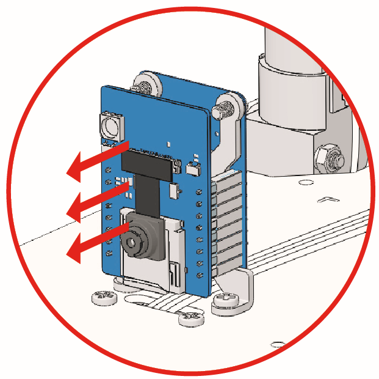

.. note::

    Hello, welcome to the SunFounder Raspberry Pi & Arduino & ESP32 Enthusiasts Community on Facebook! Dive deeper into Raspberry Pi, Arduino, and ESP32 with fellow enthusiasts.

    **Why Join?**

    - **Expert Support**: Solve post-sale issues and technical challenges with help from our community and team.
    - **Learn & Share**: Exchange tips and tutorials to enhance your skills.
    - **Exclusive Previews**: Get early access to new product announcements and sneak peeks.
    - **Special Discounts**: Enjoy exclusive discounts on our newest products.
    - **Festive Promotions and Giveaways**: Take part in giveaways and holiday promotions.

    👉 Ready to explore and create with us? Click [|link_sf_facebook|] and join today!

FAQ
================

How to Change Wi-Fi Channel?
----------------------------------

The 2.4GHz Wi-Fi band has channels ranging from 1 to 13. ESP32 supports channels 1 to 11. Other devices operating on the same channel may cause interference, leading to connection issues. To mitigate this, you can try changing the channel. By default, the channel is set to 1. When selecting a new channel, it’s recommended to skip 1-2 channels at a time. For example, if the current channel is 1, try channel 3 first, and if the signal is still poor, proceed to channel 5.

.. note::

   Changing the Wi-Fi channel requires ESP32 CAM firmware version **1.4.1 or above**. Refer to :ref:`update_firmware` for more details.

#. Keep the ESP32 CAM inserted into the adapter, then power on the Zeus Car.

   .. image:: img/plug_esp32_cam.jpg
      :width: 400

#. To activate the ESP32 CAM, move the mode switch to the **Run** position, and press the **Reset** button to reboot the R3 board.

   .. image:: img/zeus_run123.jpg
      :width: 600

#. Find ``Zeus_Car-XXXXXX`` on the list of available networks on your mobile device (tablet or smartphone), enter the password ``12345678``, and connect to it.

   .. note::

        * The current connection is to the Zeus Car hotspot, so there is no internet access. If prompted to switch networks, please choose "Stay connected".

   .. image:: img/faq_connect_zeuscar.jpg
        :width: 400

#. Open a web browser on your mobile device and navigate to ``http://192.168.4.1`` to open the ESP32 CAM settings page.

   .. image:: img/faq_ota_home.jpg
      :width: 400

.. note:: The settings page looks different depending on the ESP32 CAM firmware version. Version A (firmware 1.4.x) is a single page that holds the Wi-Fi and OTA options together, while Version B (firmware 1.5.x and above) has the **Base**, **AP**, **WIFI**, **Camera** and **OTA** tabs. Select the steps that match the interface you see.

   .. image:: img/firmware_access_ab.png
      :width: 80%
      :align: center

**Version A** (firmware 1.4.x)

   5. Under the **Wi-Fi AP Channel** section, select a different channel, then click the **Confirm** button.

      * The default channel is 1. When selecting a new channel, skip 1-2 channels at a time (e.g., from channel 1 to 3, and if needed, to 5).

      .. image:: img/faq_cam_ota_channel.png
         :width: 400

   #. A confirmation popup will appear, prompting you to reset the device. Click **Confirm**.

      .. image:: img/faq_cam_ota_reset.jpg
         :width: 400

   #. Press the **Reset** button on the R3 board to reboot the ESP32 CAM. The Zeus Car is now ready for normal operation.

      .. image:: img/zeus_run123.jpg
         :width: 600

**Version B** (firmware 1.5.x and above)

   5. Click **AP** in the side menu (or tap the **AP** tab at the bottom of the screen), then select a different channel from the **AP Channel** list.

      * The default channel is 1. When selecting a new channel, skip 1-2 channels at a time (e.g., from channel 1 to 3, and if needed, to 5).

      .. image:: img/faq_change_channel.jpg
         :width: 400

   #. When the banner "Reboot to take effect." appears at the top of the page, click **REBOOT**. The Zeus Car is now ready for normal operation.

.. _update_firmware:

How to Update Firmware for ESP32 CAM
-----------------------------------------

The ESP32 CAM broadcasts the Wi-Fi hotspot and captures video for the Zeus Car.
If the firmware is outdated, these functions may not work properly. Follow the steps below to update the firmware.

#. Keep the ESP32 CAM inserted into the adapter, then power on the Zeus Car.

   .. image:: img/plug_esp32_cam.jpg
      :width: 400

#. To activate the ESP32 CAM, move the mode switch to the **Run** position, and press the **Reset** button to reboot the R3 board.

   .. image:: img/zeus_run123.jpg
      :width: 600

#. Download the firmware file.

   * Open `the latest ESP32 CAM firmware release <https://github.com/sunfounder/ai-camera-firmware/releases/latest>`_ — the version number of the current firmware is shown at the top of the page.
   * In the **Assets** list, download the ``ai-camera-firmware.vX.X.X-ota.bin`` file. The ``-factory.bin`` file in the same list is for flashing the module with a programmer, and is not used for this update.

   .. image:: img/faq_firm_download.png
      :width: 600
     
#. Connect your mobile device to the Zeus Car's WiFi network.

   * The network name (SSID) is ``Zeus_Car-XXXXXX``, where ``XXXXXX`` are the last six characters of the ESP32 CAM's MAC address, and the password is ``12345678``.
   * If you see a warning stating "No Internet access," please choose the option to **"Stay connected."**

   .. image:: img/faq_connect_zeuscar.jpg
        :width: 400

#. Open a web browser on your mobile device and navigate to ``http://192.168.4.1`` to open the ESP32 CAM settings page.

   .. image:: img/faq_ota_home.jpg
      :width: 400

.. note:: On this page, you will see OTA upgrade options in one of two interfaces. Version A (the former) and Version B (the latter) will appear depending on your firmware version. Simply select the corresponding upgrade steps based on the interface you see.

   .. image:: img/firmware_access_ab.png
      :width: 80%
      :align: center

**Version A** (firmware 1.4.x)

   6. On the OTA page, select the firmware file and start the update:

      * Choose the previously downloaded ``ai-camera-firmware.vX.X.X-ota.bin`` file from your device and click **Add**.
      * Click the **Update** button to begin the firmware update, then wait for it to complete.

      .. image:: img/faq_ota_a.png
         :width: 700

   #. After the update is complete, the Zeus Car's WiFi hotspot name will change to ``AI Camera-XXXXXX``, and the password will remain ``12345678``. Press the **Reset** button on the R3 board, and the car registers its name again, so the hotspot becomes ``Zeus_Car-XXXXXX``.

**Version B** (firmware 1.5.x and above)

   6. On the **OTA** page, check the current firmware version displayed on the webpage.

      .. image:: img/faq_upgrade.jpg
         :width: 400
         :align: center

   #. Tap **Upgrade Firmware**, select the firmware file, and wait for the update to complete:

      * Tap the **Upgrade Firmware** button, then select the previously downloaded ``ai-camera-firmware.vX.X.X-ota.bin`` file from your device.
      * The update will begin immediately and typically takes 1-2 minutes. Once finished, select **CONFIRM** to restart the Zeus Car.

      .. image:: img/faq_ota_b.png
         :width: 700

   #. After the update is complete, the Zeus Car's WiFi hotspot name will change to ``AI Camera-XXXXXX``, and the password will remain ``12345678``. Press the **Reset** button on the R3 board, and the car registers its name again, so the hotspot becomes ``Zeus_Car-XXXXXX``.

.. _upload_zeus_code:

How to Upload the ``zeus-car.ino`` Code?
-----------------------------------------------

By default, the Zeus Car's Uno R3 board comes preloaded with the necessary firmware, allowing you to control it via APP. If your R3 board has been overwritten with other code, but you'd like to return to the default firmware and continue with the :ref:`quick_start` process, follow these steps to re-upload the code to your R3 board:

#. Use a USB cable to connect the Arduino to your computer. The ESP32-CAM and the Arduino board share the same RX (receive) and TX (transmit) pins. So, when you're uploading code, you'll need to first disconnect the ESP32-CAM to avoid any conflicts or potential issues.
   
   .. image:: img/unplug_cam.png
        :width: 400

#. Download the required firmware from the link below: 
        
   * :download:`R3 Board Firmware File <https://github.com/sunfounder/zeus-car/releases/download/1.4.5/zeus-car-1.4.5.zip>`

#. Extract the downloaded zip file, then double-click the ``update-arduino-firmware.bat`` file to run it.

   .. image:: img/faq_firmware_file.png

#. Type the corresponding number for your Zeus Car's Arduino Uno (e.g., ``1``) and press **Enter** to begin the update.

   .. note::

     * If the correct COM port does not appear, or if you're unsure which one it is, disconnect other USB devices from your computer, leaving only the rover connected.  
     * If you encounter an error like ``avrdude.exe: stk500_getsync() attempt 1 of 10: not in sync: resp=0xXX``, make sure to disconnect the ESP32-CAM as the first step.

   .. image:: img/faq_firmware_port.png

#. After a short while, the new code will be successfully uploaded to the Uno R3 board on Zeus Car. If you fail to upload successfully after multiple attempts, you can run ``update-arduino-firmware-with-bootloader.bat``.

   .. image:: img/faq_firmware_finish.png

.. _ap_to_sta:

How to Control the Zeus Car Using Your Home WiFi?
-------------------------------------------------
By default, the Uno R3 is preloaded with code configured in APP mode. This means the Zeus Car will broadcast a hotspot, allowing you to connect your mobile device to control it via the SunFounder Controller APP.

If you prefer to control the car using your home WiFi, you can let the ESP32 CAM join your home network. The camera keeps working in AP + STA dual mode, so the Zeus Car hotspot stays available as well:

#. Power on the Zeus Car. To activate the ESP32 CAM, move the mode switch to the **Run** position, and press the **Reset** button to reboot the R3 board.

   .. image:: img/zeus_run123.jpg
      :width: 600

#. Connect your mobile device to the Zeus Car's WiFi network.

   * The network name (SSID) is ``Zeus_Car-XXXXXX``, where ``XXXXXX`` are the last six characters of the ESP32 CAM's MAC address, and the password is ``12345678``.
   * If you see a warning stating "No Internet access," please choose the option to **"Stay connected."**

   .. image:: img/faq_connect_zeuscar.jpg
        :width: 400

#. Open a web browser on your mobile device and navigate to ``http://192.168.4.1`` to open the ESP32 CAM settings page.

   .. image:: img/faq_ota_home.jpg
      :width: 400

#. Click **WIFI** in the side menu (or tap the **WIFI** tab at the bottom of the screen), then enter the name and the password of your home WiFi network.

   * Put your home WiFi's name in **STA SSID** — you can also pick it from the scanned list — and its password in **STA password**.
   * Tap **CONFIRM** to save the settings. Once the credentials are stored, the page shows "Success, Restart to apply."
   * After the reboot, the **Base** page shows the IP address that your router assigned to the camera in **IP Address**.

   .. image:: img/faq_set_sta.jpg
      :width: 400

#. Reboot the ESP32 CAM: click **Reboot** on the page, or press the **Reset** button on the R3 board. The ESP32 CAM now connects to your home WiFi and keeps the Zeus Car hotspot at the same time.

   .. note::

      With ESP32 CAM firmware **1.5.4** and above, the camera runs in AP + STA dual mode and the serial command ``MODE`` is ignored. Changing ``WIFI_MODE``, ``SSID`` and ``PASSWORD`` in the R3 sketch therefore no longer switches the camera to STA mode — configure the home WiFi as described above instead.

#. Ensure your mobile device (tablet or smartphone) is connected to your home WiFi network.

   .. image:: img/faq_connect_wifi.jpg
        :width: 400
        :align: center

#. Open the SunFounder Controller App, tap the "+" icon to create a new controller, select the "Zeus Car" preset, enter a name or tap "Confirm" to proceed.

   .. image:: img/app_preset.jpg
        :width: 600

#. The app will automatically search for the Zeus Car. After a moment, you will see a prompt stating "Connected Successfully."

   .. image:: img/app_edit.jpg
        :width: 600
    
#. Now, tap the |app_run| button enables you to view the live video feed from the camera and control the rover using the provided widgets. 

   .. image:: img/app_run123.png
        :width: 600 
    
How to Invert the Camera?  
---------------------------

If you find the camera feed upside down while using the SunFounder Controller, you can easily correct it through the app. Follow these steps:  

1. Tap the |app_edit| button in the top-right corner.  

   .. image:: img/faq_edit.png  
        :width: 500 

2. Click the **camera** button to open a popup. Toggle the **Inverted** switch to turn it on.  

   .. image:: img/faq_inverted.png  
        :width: 500  

3. Save your settings.  

   .. image:: img/faq_save.png  
        :width: 500 

4. Return to the control interface and click the |app_run| button.  

   .. note::  

        Occasionally, the camera feed may not appear. If this happens, pause the controller and then click the run button again.  

   .. image:: img/faq_run.png  
        :width: 500 

Alternatively, you can flip the camera from the ESP32 CAM settings page: connect your mobile device to the Zeus Car's WiFi network, open ``http://192.168.4.1``, and switch on **Horizontal flip** or **Vertical flip** on the **Camera** page.

.. image:: img/faq_camera.jpg
     :width: 400

Compilation error: SoftPWM.h: No such file or directory?
--------------------------------------------------------------
If you get a "Compilation error: SoftPWM.h: No such file or directory" prompt, it means you don't have the ``SoftPWM`` library installed.

Please refer to :ref:`ar_install_lib` to install the required libraries.

avrdude: stk500_getsync() attempt 10 of 10: not in sync: resp=0x6e?
---------------------------------------------------------------------------

If the following message keeps appearing after clicking the Upload button when the board and port have been selected correctly.

.. code-block::

    avrdude: stk500_recv(): programmer is not responding
    avrdude: stk500_getsync() attempt 1 of 10: not in sync: resp=0x00
    avrdude: stk500_recv(): programmer is not responding
    avrdude: stk500_getsync() attempt 2 of 10: not in sync: resp=0x00
    avrdude: stk500_recv(): programmer is not responding
    avrdude: stk500_getsync() attempt 3 of 10: not in sync: resp=0x00

At this point, you need to make sure that the ESP32 CAM is unplugged.

The ESP32-CAM and the Arduino board share the same RX (receive) and TX (transmit) pins. So, when you're uploading code, you'll need to first disconnect the ESP32-CAM to avoid any conflicts or potential issues.

.. _stt_android:

How can I use the STT feature on my Android device?
------------------------------------------------------------------------

The STT feature requires the Android mobile device to be connected to the Internet and to install the **Google service component**.

Now follow the steps below.

#. Connect the Zeus Car to your home WiFi network, so that both the car and your mobile device have Internet access. Follow :ref:`ap_to_sta` to save the home WiFi in the ESP32 CAM settings page — you do not need to modify or re-upload the ``Zeus_Car.ino`` code.

#. Search ``google`` in Google Play, find the app shown below and install it.

    .. image:: img/google_voice.png

#. Connect your mobile device to the same home WiFi network.

    .. image:: img/sta_wifi.png
        :width: 400
        :align: center

#. Open the controller previously created in SunFounder Controller and connect it to the Zeus Car through the |app_connect| button.

    .. image:: img/app_connect.png
        :width: 500
        :align: center

#. Tap and hold the |app_speech_m|  widget after clicking the |app_run| button. A prompt will appear indicating that it is listening. Say the following command to move the car.

    * ``stop``: All movements of the car can be stopped.
    * ``pasue``: The function is basically the same as Stop, but if the head of the car is not facing the direction originally set, it will slowly move to the set direction.
    * ``forward`` 
    * ``backward`` 
    * ``left forward``
    * ``left backward``
    * ``right forward``
    * ``right backward``
    * ``move left``
    * ``move right``