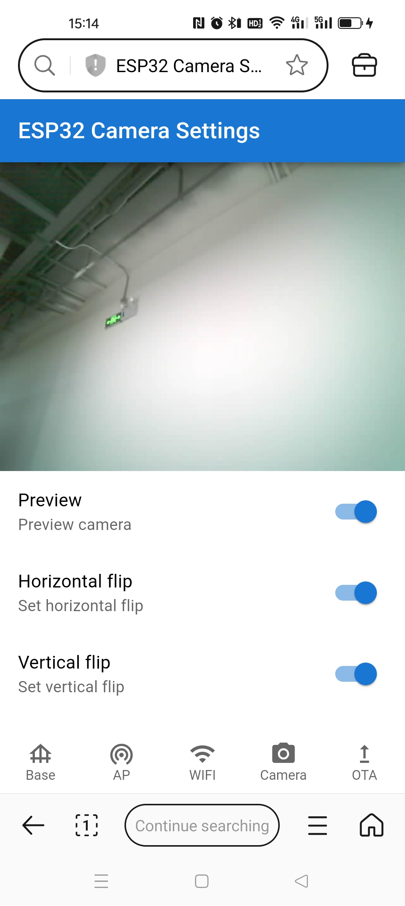

.. note:: 

    Bonjour et bienvenue dans la communauté SunFounder Raspberry Pi & Arduino & ESP32 sur Facebook ! Rejoignez des passionnés pour approfondir vos connaissances sur Raspberry Pi, Arduino et ESP32.

    **Pourquoi nous rejoindre ?**

    - **Support d’experts** : Obtenez de l’aide pour résoudre les problèmes après-vente et relever les défis techniques grâce à notre communauté et notre équipe.
    - **Apprenez & Partagez** : Échangez des astuces et tutoriels pour perfectionner vos compétences.
    - **Aperçus exclusifs** : Accédez en avant-première aux annonces de nouveaux produits et aux coulisses du développement.
    - **Remises spéciales** : Bénéficiez d’offres exclusives sur nos derniers produits.
    - **Promotions festives et cadeaux** : Participez à des concours et offres spéciales à l’occasion des fêtes.

    👉 Prêt à explorer et à créer avec nous ? Cliquez sur [|link_sf_facebook|] et rejoignez-nous dès aujourd’hui !

FAQ
================

Comment changer de canal Wi-Fi ?
-------------------------------------

La bande Wi-Fi 2,4 GHz dispose de 13 canaux, et l’ESP32 prend en charge les canaux 1 à 11. D’autres appareils utilisant le même canal peuvent causer des interférences et entraîner des problèmes de connexion. Pour atténuer ce problème, il est possible de modifier le canal. Par défaut, le canal est défini sur 1. Lors du changement de canal, il est recommandé d’en sauter 1 à 2 à la fois. Par exemple, si le canal actuel est 1, essayez d’abord le canal 3, puis, si le signal est toujours faible, passez au canal 5.

.. note::

   Le changement de canal Wi-Fi nécessite le firmware **1.4.1 ou supérieur** de l'ESP32 CAM. Consultez :ref:`update_firmware` pour plus de détails.

#. Maintenez l'ESP32 CAM inséré dans l'adaptateur, puis allumez le Zeus Car.

   .. image:: img/plug_esp32_cam.jpg
      :width: 400

#. Pour activer l'ESP32 CAM, placez le commutateur de mode sur **Run** et appuyez sur le bouton **Reset** pour redémarrer la carte R3.

   .. image:: img/zeus_run123.jpg
      :width: 600

#. Recherchez ``Zeus_Car-XXXXXX`` dans la liste des réseaux disponibles de votre appareil mobile (tablette ou smartphone), saisissez le mot de passe ``12345678`` et connectez-vous. ``XXXXXX`` correspond aux six derniers caractères de l'adresse MAC de l'ESP32 CAM ; le nom du point d'accès est donc différent sur chaque voiture.

   .. note::

        * La connexion actuelle se fait sur le point d'accès du Zeus Car : il n'y a donc pas d'accès Internet. Si vous êtes invité à changer de réseau, choisissez "Rester connecté".

   .. image:: img/faq_connect_zeuscar.jpg
        :width: 400

#. Ouvrez un navigateur web sur votre appareil mobile et rendez-vous sur ``http://192.168.4.1`` pour ouvrir la page de réglages de l'ESP32 CAM.

   .. image:: img/faq_ota_home.jpg
      :width: 400

.. note:: Cette page est différente selon la version du firmware de l'ESP32 CAM. La version A (firmware 1.4.x) est une page unique qui regroupe les options Wi-Fi et OTA, tandis que la version B (firmware 1.5.x et supérieur) présente les onglets **Base**, **AP**, **WIFI**, **Camera** et **OTA**. Suivez les étapes correspondant à l'interface affichée.

   .. image:: img/firmware_access_ab.png
      :width: 80%
      :align: center

**Version A** (firmware 1.4.x)

   5. Dans la section **Wi-Fi AP Channel**, sélectionnez un autre canal puis cliquez sur le bouton **Confirm**.

      * Le canal par défaut est 1. Lors du changement, sautez 1 à 2 canaux à la fois (par exemple du canal 1 au 3, puis au 5 si nécessaire).

      .. image:: img/faq_cam_ota_channel.png
         :width: 400

   #. Une fenêtre de confirmation s'affiche et vous invite à redémarrer l'appareil. Cliquez sur **Confirm**.

      .. image:: img/faq_cam_ota_reset.jpg
         :width: 400

   #. Appuyez sur le bouton **Reset** de la carte R3 pour redémarrer l'ESP32 CAM. Le Zeus Car est maintenant prêt à fonctionner normalement.

      .. image:: img/zeus_run123.jpg
         :width: 600

**Version B** (firmware 1.5.x et supérieur)

   5. Cliquez sur **AP** dans le menu latéral (ou touchez l'onglet **AP** en bas de l'écran), puis sélectionnez un autre canal dans la liste **AP Channel**.

      * Le canal par défaut est 1. Lors du changement, sautez 1 à 2 canaux à la fois (par exemple du canal 1 au 3, puis au 5 si nécessaire).

      .. image:: img/faq_change_channel.jpg
         :width: 400

   #. Lorsque la bannière « Reboot to take effect. » apparaît en haut de la page, cliquez sur **REBOOT**. Le Zeus Car est maintenant prêt à fonctionner normalement.

.. _update_firmware:

Comment mettre à jour le firmware de l’ESP32 CAM ?
-----------------------------------------------------

Suivez ces étapes détaillées pour mettre à jour le firmware de votre ESP32 CAM :

#. Maintenez l'ESP32 CAM inséré dans l'adaptateur, puis allumez le Zeus Car.

   .. image:: img/plug_esp32_cam.jpg
      :width: 400

#. Pour activer l'ESP32 CAM, placez le commutateur de mode sur **Run** et appuyez sur le bouton **Reset** pour redémarrer la carte R3.

   .. image:: img/zeus_run123.jpg
      :width: 600

#. Téléchargez le fichier du firmware.

   * Ouvrez `la dernière version du firmware de l'ESP32 CAM <https://github.com/sunfounder/ai-camera-firmware/releases/latest>`_ — le numéro de version du firmware actuel est affiché en haut de la page.
   * Dans la liste **Assets**, téléchargez le fichier ``ai-camera-firmware.vX.X.X-ota.bin``. Le fichier ``-factory.bin`` de cette même liste sert à flasher le module avec un programmateur ; il n'est pas utilisé pour cette mise à jour.

   .. image:: img/faq_firm_download.png
      :width: 600

#. Connectez votre appareil mobile au réseau Wi-Fi du Zeus Car.

   * Le nom du réseau (SSID) est ``Zeus_Car-XXXXXX``, où ``XXXXXX`` correspond aux six derniers caractères de l'adresse MAC de l'ESP32 CAM ; le mot de passe est ``12345678``.
   * Si un message « Pas d'accès Internet » apparaît, choisissez l'option **« Rester connecté »**.

   .. image:: img/faq_connect_zeuscar.jpg
        :width: 400

#. Ouvrez un navigateur web sur votre appareil mobile et rendez-vous sur ``http://192.168.4.1`` pour ouvrir la page de réglages de l'ESP32 CAM.

   .. image:: img/faq_ota_home.jpg
      :width: 400

.. note:: Sur cette page, les options de mise à jour OTA apparaissent dans l'une des deux interfaces. La version A (la première) et la version B (la seconde) s'affichent selon la version du firmware. Suivez les étapes correspondant à l'interface affichée.

   .. image:: img/firmware_access_ab.png
      :width: 80%
      :align: center

**Version A** (firmware 1.4.x)

   6. Sur la page OTA, sélectionnez le fichier du firmware et lancez la mise à jour :

      * Choisissez le fichier ``ai-camera-firmware.vX.X.X-ota.bin`` téléchargé précédemment et cliquez sur **Add**.
      * Cliquez sur le bouton **Update** pour lancer la mise à jour, puis attendez qu'elle se termine.

      .. image:: img/faq_ota_a.png
         :width: 700

   #. Une fois la mise à jour terminée, le point d'accès du Zeus Car s'appelle ``AI Camera-XXXXXX`` et le mot de passe reste ``12345678``. Appuyez sur le bouton **Reset** de la carte R3 pour que la voiture enregistre à nouveau son nom ; le point d'accès redevient alors ``Zeus_Car-XXXXXX``.

**Version B** (firmware 1.5.x et supérieur)

   6. Sur la page **OTA**, vérifiez la version du firmware affichée.

      .. image:: img/faq_upgrade.jpg
         :width: 400
         :align: center

   #. Touchez **Upgrade Firmware**, sélectionnez le fichier du firmware et attendez la fin de la mise à jour :

      * Touchez le bouton **Upgrade Firmware**, puis sélectionnez le fichier ``ai-camera-firmware.vX.X.X-ota.bin`` téléchargé précédemment.
      * La mise à jour démarre immédiatement et prend généralement 1 à 2 minutes. À la fin, sélectionnez **CONFIRM** pour redémarrer le Zeus Car.

      .. image:: img/faq_ota_b.png
         :width: 700

   #. Une fois la mise à jour terminée, le point d'accès du Zeus Car s'appelle ``AI Camera-XXXXXX`` et le mot de passe reste ``12345678``. Appuyez sur le bouton **Reset** de la carte R3 pour que la voiture enregistre à nouveau son nom ; le point d'accès redevient alors ``Zeus_Car-XXXXXX``.

.. _upload_zeus_code:

Comment téléverser le code ``zeus-car.ino`` ? 
-----------------------------------------------

Par défaut, la carte Uno R3 de la Zeus Car est préchargée avec le firmware nécessaire, ce qui permet de la contrôler via l'application mobile. Si votre carte R3 a été écrasée par un autre code et que vous souhaitez revenir au firmware d’origine pour suivre le processus :ref:`quick_start`, suivez ces étapes pour réinstaller le code sur votre carte R3 :

#. Utilisez un câble USB pour connecter la carte Arduino à votre ordinateur. L'ESP32-CAM et la carte Arduino partagent les mêmes broches RX (réception) et TX (transmission). Pour éviter les conflits lors du téléversement du code, commencez par déconnecter l’ESP32-CAM.

   .. image:: img/unplug_cam.png
        :width: 400

#. Téléchargez le firmware requis depuis le lien ci-dessous : 
       
   * :download:`Fichier du firmware R3 Board <https://github.com/sunfounder/zeus-car/releases/download/1.4.5/zeus-car-1.4.5.zip>`

#. Extrayez le fichier ZIP téléchargé, puis double-cliquez sur ``update-arduino-firmware.bat`` pour l’exécuter.

   .. image:: img/faq_firmware_file.png

#. Tapez le numéro correspondant à votre Zeus Car (ex. : ``1``), puis appuyez sur **Enter** pour démarrer la mise à jour.

   .. note::

     * Si le port COM correct n’apparaît pas ou si vous ne savez pas lequel choisir, déconnectez les autres périphériques USB de votre ordinateur, en laissant uniquement la Zeus Car branchée.  
     * Si vous rencontrez une erreur comme ``avrdude.exe: stk500_getsync() attempt 1 of 10: not in sync: resp=0xXX``, assurez-vous d’avoir déconnecté l’ESP32-CAM avant de continuer.

   .. image:: img/faq_firmware_port.png

#. Après quelques instants, le nouveau code sera correctement téléversé sur la carte Uno R3 de la Zeus Car. Si l’opération échoue après plusieurs tentatives, essayez d’exécuter ``update-arduino-firmware-with-bootloader.bat``.

   .. image:: img/faq_firmware_finish.png

.. _ap_to_sta:

Comment contrôler la Zeus Car via le Wi-Fi domestique ?
----------------------------------------------------------

Par défaut, le Uno R3 est préchargé avec un code en mode APP, ce qui signifie que la Zeus Car émettra un hotspot auquel vous pouvez vous connecter avec votre mobile pour la contrôler via l’**application SunFounder Controller**.

Si vous préférez piloter la voiture via votre Wi-Fi domestique, vous pouvez demander à l'ESP32 CAM de rejoindre votre réseau. La caméra continue de fonctionner en mode double AP + STA : le point d'accès du Zeus Car reste donc lui aussi disponible :

#. Allumez le Zeus Car. Pour activer l'ESP32 CAM, placez le commutateur de mode sur **Run** et appuyez sur le bouton **Reset** pour redémarrer la carte R3.

   .. image:: img/zeus_run123.jpg
      :width: 600

#. Connectez votre appareil mobile au réseau Wi-Fi du Zeus Car.

   * Le nom du réseau (SSID) est ``Zeus_Car-XXXXXX``, où ``XXXXXX`` correspond aux six derniers caractères de l'adresse MAC de l'ESP32 CAM ; le mot de passe est ``12345678``.
   * Si un message « Pas d'accès Internet » apparaît, choisissez l'option **« Rester connecté »**.

   .. image:: img/faq_connect_zeuscar.jpg
        :width: 400

#. Ouvrez un navigateur web sur votre appareil mobile et rendez-vous sur ``http://192.168.4.1`` pour ouvrir la page de réglages de l'ESP32 CAM.

   .. image:: img/faq_ota_home.jpg
      :width: 400

#. Cliquez sur **WIFI** dans le menu latéral (ou touchez l'onglet **WIFI** en bas de l'écran), puis saisissez le nom et le mot de passe de votre réseau Wi-Fi domestique.

   * Indiquez le nom de votre Wi-Fi domestique dans **STA SSID** — vous pouvez aussi le choisir dans la liste scannée — et son mot de passe dans **STA password**.
   * Touchez **CONFIRM** pour enregistrer. Une fois les identifiants stockés, la page affiche « Success, Restart to apply. ».
   * Après le redémarrage, la page **Base** affiche dans **IP Address** l'adresse IP que votre routeur a attribuée à la caméra.

   .. image:: img/faq_set_sta.jpg
      :width: 400

#. Redémarrez l'ESP32 CAM : cliquez sur **Reboot** sur la page ou appuyez sur le bouton **Reset** de la carte R3. L'ESP32 CAM se connecte désormais à votre Wi-Fi domestique tout en conservant le point d'accès du Zeus Car.

   .. note::

      Avec le firmware **1.5.4** et supérieur de l'ESP32 CAM, la caméra fonctionne en mode double AP + STA et la commande série ``MODE`` est ignorée. Modifier ``WIFI_MODE``, ``SSID`` et ``PASSWORD`` dans le sketch de la R3 ne bascule donc plus la caméra en mode STA — configurez le Wi-Fi domestique comme décrit ci-dessus.

#. Vérifiez que votre appareil mobile (tablette ou smartphone) est bien connecté à votre réseau Wi-Fi domestique.

   .. image:: img/faq_connect_wifi.jpg
        :width: 400
        :align: center

#. Ouvrez l’application SunFounder Controller, appuyez sur l’icône "+" pour créer un nouveau contrôleur, sélectionnez le préréglage "Zeus Car", entrez un nom ou appuyez sur "Confirmer".

   .. image:: img/app_preset.jpg
        :width: 600

#. L’application recherchera automatiquement la Zeus Car. Après quelques instants, un message s’affichera indiquant "Connexion réussie".

   .. image:: img/app_edit.jpg
        :width: 600
    
#. Maintenant, appuyez sur le bouton |app_run| pour afficher le flux vidéo en direct de la caméra et contrôler le robot à l’aide des widgets fournis.

   .. image:: img/app_run123.png
        :width: 600

Comment inverser l'affichage de la caméra ?  
----------------------------------------------

Si l’image de la caméra apparaît à l’envers dans l’application SunFounder Controller, vous pouvez facilement la corriger en suivant ces étapes :  

1. Appuyez sur le bouton |app_edit| en haut à droite.  

   .. image:: img/faq_edit.png  
        :width: 500 

2. Cliquez sur le bouton caméra pour ouvrir une fenêtre contextuelle. Activez l'option Inversé en basculant l’interrupteur.  

   .. image:: img/faq_inverted.png  
        :width: 500  

3. Enregistrez vos paramètres.  

   .. image:: img/faq_save.png  
        :width: 500 

4. Retournez à l’interface de contrôle et appuyez sur le bouton |app_run|.  

   .. note::  

        Parfois, l’image de la caméra peut ne pas s’afficher immédiatement. Si cela se produit, mettez l’application en pause, puis cliquez à nouveau sur le bouton Exécuter.  

   .. image:: img/faq_run.png  
        :width: 500 

Vous pouvez également inverser la caméra depuis la page de réglages de l'ESP32 CAM : connectez votre appareil mobile au réseau Wi-Fi du Zeus Car, ouvrez ``http://192.168.4.1`` et activez **Horizontal flip** ou **Vertical flip** sur la page **Camera**.

Erreur de compilation : SoftPWM.h: No such file or directory ?  
------------------------------------------------------------------
Si vous obtenez le message "Compilation error: SoftPWM.h: No such file or directory", cela signifie que la bibliothèque ``SoftPWM`` n’est pas installée.

Veuillez consulter :ref:`ar_install_lib` pour installer les bibliothèques nécessaires.

Erreur avrdude: stk500_getsync() attempt 10 of 10: not in sync: resp=0x6e ?  
----------------------------------------------------------------------------

Si le message d'erreur suivant s'affiche à plusieurs reprises après avoir cliqué sur le bouton Téléverser, alors que la carte et le port sont correctement sélectionnés :

.. code-block::

    avrdude: stk500_recv(): programmer is not responding
    avrdude: stk500_getsync() attempt 1 of 10: not in sync: resp=0x00
    avrdude: stk500_recv(): programmer is not responding
    avrdude: stk500_getsync() attempt 2 of 10: not in sync: resp=0x00
    avrdude: stk500_recv(): programmer is not responding
    avrdude: stk500_getsync() attempt 3 of 10: not in sync: resp=0x00

Dans ce cas, assurez-vous que l'ESP32 CAM est bien débranché.

L’**ESP32-CAM** et la carte Arduino partagent les mêmes broches RX (réception) et TX (transmission). Par conséquent, lors du téléversement du code, il est indispensable de déconnecter d'abord l'ESP32-CAM afin d'éviter tout conflit ou problème potentiel.

.. image:: img/unplug_cam.png
    :width: 400
    :align: center

.. _stt_android:

Comment utiliser la fonctionnalité STT sur un appareil Android ?  
--------------------------------------------------------------------

La fonctionnalité STT (Speech-to-Text) nécessite que l’appareil Android soit connecté à Internet et dispose du service Google installé.

Suivez ces étapes pour l’activer :

#. Connectez le Zeus Car à votre réseau Wi-Fi domestique afin que la voiture et votre appareil mobile aient tous deux accès à Internet. Suivez :ref:`ap_to_sta` pour enregistrer le Wi-Fi domestique sur la page de réglages de l'ESP32 CAM — vous n'avez pas besoin de modifier ni de recharger le code ``Zeus_Car.ino``.
#. Recherchez ``google`` sur Google Play, trouvez l’application illustrée ci-dessous et installez-la.

    .. image:: img/google_voice.png

#. Connectez votre appareil mobile au même réseau Wi-Fi domestique.

    .. image:: img/sta_wifi.png
        :width: 400
        :align: center

#. Ouvrez le contrôleur précédemment créé dans l’application SunFounder Controller et connectez-le à Zeus Car via le bouton |app_connect|.

    .. image:: img/app_connect.png
        :width: 500
        :align: center

#. Appuyez longuement sur le  |app_speech_m| après avoir cliqué sur le bouton |app_run|. Une invite apparaîtra indiquant que l’application écoute. Prononcez l’une des commandes suivantes pour déplacer la voiture :

    * ``stop`` : Arrête tous les mouvements de la voiture.  
    * ``pause`` : Fonction similaire à Stop, mais si l’orientation de la voiture ne correspond plus à sa position initiale, elle ajustera lentement sa direction.  
    * ``forward`` : Avancer  
    * ``backward`` : Reculer  
    * ``left forward`` : Avancer vers la gauche  
    * ``left backward`` : Reculer vers la gauche  
    * ``right forward`` : Avancer vers la droite  
    * ``right backward`` : Reculer vers la droite  
    * ``move left`` : Se déplacer latéralement vers la gauche  
    * ``move right`` : Se déplacer latéralement vers la droite  
