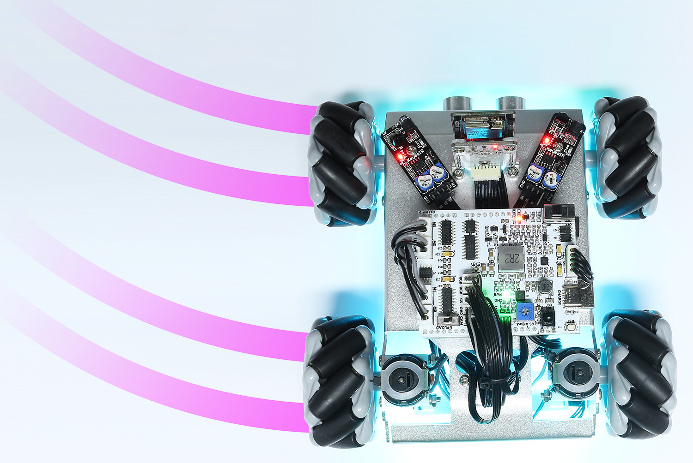
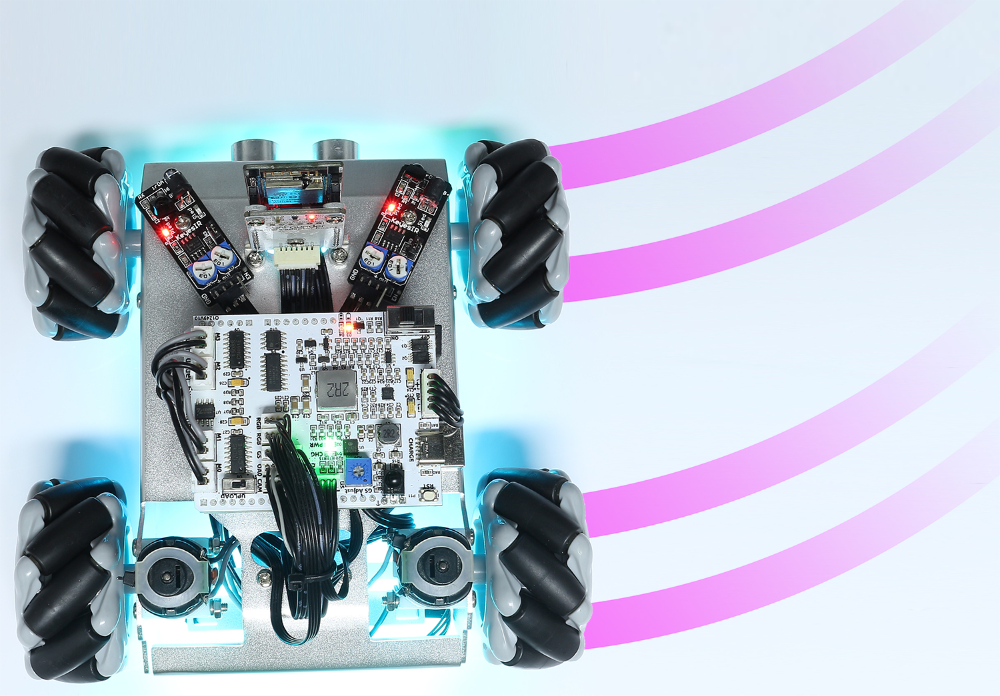
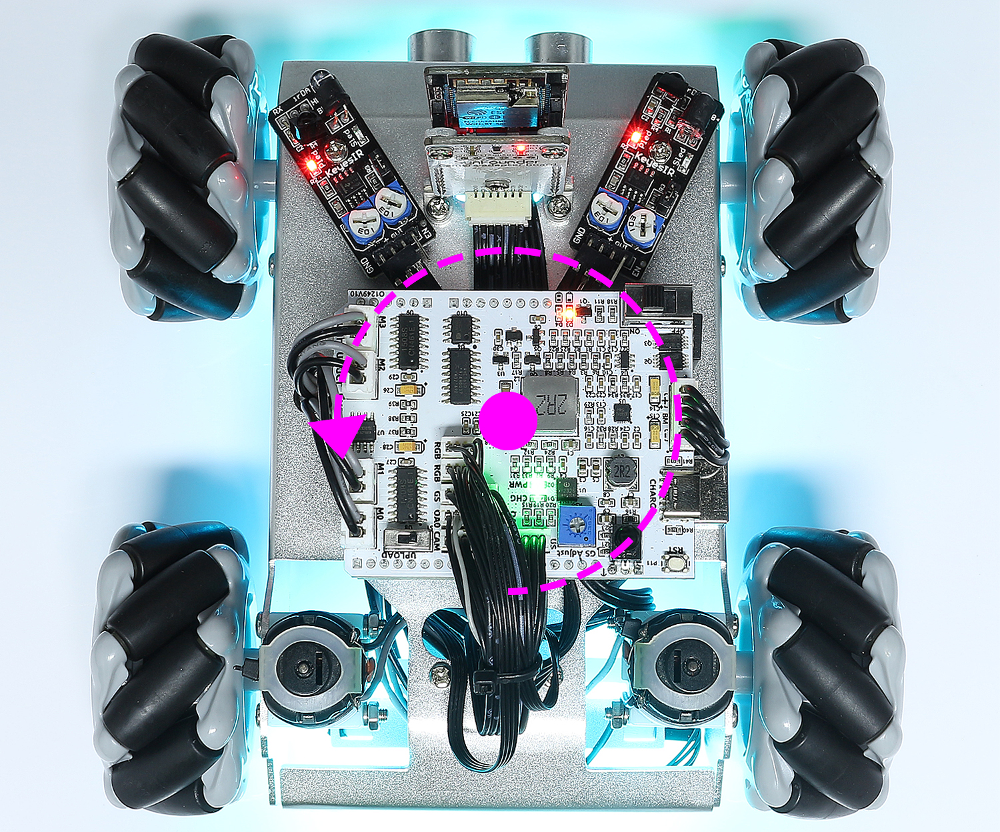

.. note::

    Bonjour et bienvenue dans la communauté des passionnés de SunFounder Raspberry Pi, Arduino et ESP32 sur Facebook ! Plongez dans l’univers de Raspberry Pi, Arduino et ESP32 avec d’autres passionnés et approfondissez vos connaissances.

    **Pourquoi nous rejoindre ?**

    - **Support d'experts** : Bénéficiez de l’aide de notre communauté et de notre équipe pour résoudre les problèmes après-vente et relever les défis techniques.
    - **Apprentissage et partage** : Échangez des conseils et des tutoriels pour perfectionner vos compétences.
    - **Aperçus exclusifs** : Accédez en avant-première aux annonces de nouveaux produits et aux exclusivités.
    - **Réductions spéciales** : Profitez d’offres exclusives sur nos dernières innovations.
    - **Promotions et cadeaux festifs** : Participez à des concours et à des offres promotionnelles saisonnières.

    👉 Prêt à explorer et à créer avec nous ? Cliquez sur [|link_sf_facebook|] et rejoignez-nous dès aujourd’hui !

.. _play_app_control:

Contrôle via l'APP
=========================

Pour contrôler le Zeus Car depuis votre appareil mobile, vous devez télécharger l'application SunFounder Controller, vous connecter au réseau local du Zeus Car, puis créer votre propre contrôleur dans l'application.

.. raw:: html

    

        <video center loop autoplay muted style = "max-width:70%">
            <source src="../_static/video/app_control.mp4"  type="video/mp4">
            Your browser does not support the video tag.
        </video>
    

.. raw:: html
    
       

Guide rapide
---------------------

Voici une vidéo tutorielle rapide. Regardez-la avant de suivre les instructions détaillées ci-dessous.

.. raw:: html

    

        <video loop controls style = "max-width:90%">
            <source src="../_static/video/app_control_quick_guide.mp4"  type="video/mp4">
            Your browser does not support the video tag.
        </video>
    

.. raw:: html
    
       

#. Démarrons le Zeus Car.

   * Lors de la première utilisation ou après avoir débranché le câble de la batterie, le Zeus Car Shield active son circuit de protection contre la décharge excessive.
   * Vous devez alors brancher le câble Type-C pendant environ 5 secondes.

     .. raw:: html
     
         

             <video center loop autoplay muted style = "max-width:70%">
                 <source src="../_static/video/activate_battery.mp4"  type="video/mp4">
                 Your browser does not support the video tag.
             </video>
         

     
     .. raw:: html
         
          

   * Si l'indicateur d’alimentation s'allume, cela signifie que le mode de protection est désactivé. Ensuite, vérifiez les indicateurs de batterie. Si les deux sont éteints, continuez à charger la batterie en branchant le câble Type-C.

     .. image:: img/zeus_power.jpg
         :width: 500
         :align: center
     
     .. raw:: html
         
            

   * Ensuite, basculez le petit interrupteur vers la droite pour établir la communication entre la voiture et la ESP32-CAM. Puis, appuyez sur le bouton Reset pour redémarrer le code. Vous verrez alors les lumières sous la voiture passer de l’orange au bleu clair.

     .. raw:: html
     
         

             <video center loop autoplay muted style = "max-width:70%">
                 <source src="../_static/video/re_run_code.mp4"  type="video/mp4">
                 Your browser does not support the video tag.
             </video>
         

     
     .. raw:: html
         
          

#. Installez `SunFounder Controller <https://docs.sunfounder.com/projects/sf-controller/en/latest/>`_ depuis **l'App Store (iOS)** ou **Google Play (Android)**.

#. Connectez-vous au WLAN ``Zeus_Car-XXXXXX``.

   * Recherchez ``Zeus_Car-XXXXXX`` dans les paramètres Wi-Fi de votre téléphone (ou tablette), saisissez le mot de passe ``12345678``, puis connectez-vous. ``XXXXXX`` correspond aux six derniers caractères de l'adresse MAC de l'ESP32 CAM ; le nom du point d'accès est donc différent sur chaque voiture.

     .. image:: ../img/faq_connect_zeuscar.jpg
         :width: 400

   * Le mode de connexion par défaut est le mode AP. Après la connexion, un message indiquera que ce réseau WLAN n'a pas d'accès Internet ; choisissez de poursuivre la connexion.

     .. image:: img/app_no_internet.png

#. Créez un contrôleur.

   * Pour ajouter un contrôleur dans SunFounder Controller, cliquez sur l’icône **+**.

     .. image:: img/app1.png
         :width: 500
         :align: center
     
     .. raw:: html
         
            

   * Des contrôleurs prédéfinis sont disponibles pour certains produits. Ici, choisissez **Zeus Car**, attribuez-lui un nom ou appuyez simplement sur **Confirm**.

     .. image:: img/app_preset.jpg
         :width: 500
         :align: center
     
     .. raw:: html
         
            

   * Une fois à l'intérieur, l’application recherchera automatiquement le Zeus Car. Après quelques secondes, un message "Connexion réussie" s’affichera.

     .. image:: img/app_edit.jpg
         :width: 500
         :align: center
     
     .. raw:: html
         
           

   * Maintenant, appuyez sur le bouton |app_run| pour afficher le flux vidéo en direct de la caméra et contrôler la voiture à l'aide des widgets fournis.

     .. image:: img/app_run123.png
         :width: 500
         :align: center
     
     .. raw:: html
         
            

#. Fonctionnalités des widgets.

        * :ref:`app_compass_cali` : Active la calibration du compas.
        * **Stop(F)** : Arrête tous les mouvements de la voiture.
        * **Reset Heading(G)** : Une fois la voiture positionnée manuellement dans une direction, cliquez sur ce widget pour enregistrer cette direction comme référence. Cela permet d’orienter rapidement la voiture sans avoir à la tourner lentement via d’autres commandes.
        * :ref:`app_speech_control` : Passe en mode de contrôle vocal.
        * :ref:`app_drift` : Active la fonction drift.
        * :ref:`app_move` : Contrôle les mouvements de la voiture dans toutes les directions.
        
        * :ref:`app_line_track` : Ces deux widgets permettent d’activer le mode suivi de ligne.
        
            * **Line no Mag(M)** : Active le mode suivi de ligne sans être influencé par le champ magnétique. La voiture ajustera continuellement son orientation pendant le suivi.
            * **Line(N)** : Active le mode suivi de ligne avec alignement sur un champ magnétique, garantissant une orientation constante de la voiture.

        * :ref:`app_follow` : Active le mode suivi automatique.
        * :ref:`app_avoid` : Active le mode évitement d'obstacles.
        * :ref:`app_rotate_drift` : Permet de contrôler la direction de la tête du véhicule.

.. _app_compass_cali:

Calibration(E) 
--------------------------

Activez l'étalonnage du compas en cliquant sur le bouton |app_cali_e|.

Placez le **Zeus Car** au sol. Une fois l’étalonnage activé, la voiture commencera à tourner dans le sens antihoraire et s’arrêtera au bout d’environ une minute. Si elle tourne pendant plus de deux minutes, cela signifie que le champ magnétique est trop complexe à cet endroit. Essayez de changer de lieu et relancez l’étalonnage.

.. _app_drift:

Activation du Drift (J)
--------------------------

Cliquez sur le bouton |app_drift_j| pour activer la fonction de drift.

* En faisant glisser le widget |app_rotate_q| vers la gauche (sens antihoraire), le Zeus Car effectuera un drift vers la droite. Lorsque vous relâchez, il s’arrêtera à sa position actuelle.

.. raw:: html
    
       
 
* De même, en faisant glisser le widget |app_rotate_q| vers la droite (sens horaire), le Zeus Car effectuera un drift vers la gauche et s’arrêtera à sa position actuelle.

.. raw:: html
    
       
 
.. _app_move:

Déplacement dans toutes les directions (K)
-----------------------------------------------

.. raw:: html

   <video loop autoplay muted style = "max-width:80%">
      <source src="../_static/video/basic_movement.mp4"  type="video/mp4">
      Your browser does not support the video tag.
   </video>

.. raw:: html
    
         

Le **Zeus Car** se déplacera dans la direction correspondante lorsque vous faites glisser le widget |app_move_k|.

.. image:: img/joystick_move.png
    :align: center

.. raw:: html
    
       

Chaque mouvement est déclenché une seule fois à chaque glissement. Tant que vous maintenez la pression sur l’écran, la voiture continuera à se déplacer.

.. image:: img/zeus_move.jpg
    :width: 500
    :align: center

.. raw:: html
    
       
 
.. _app_speech_control:

Commande Vocale (I)
----------------------

En appuyant sur le widget |app_speech_m|, vous activez la fonction **STT (Speech to Text)**.

L’application SunFounder Controller utilise le moteur de reconnaissance vocale de votre appareil mobile. Lorsque vous maintenez enfoncé le widget **Speech(I)** et parlez dans votre appareil, votre voix est capturée, convertie en texte, puis envoyée au Zeus Car. 

Si le texte correspond à l’une des commandes pré-enregistrées, la voiture exécutera l’action correspondante.

Voici les commandes disponibles :

* ``stop`` : Arrête tous les mouvements.
* ``pause`` : Fonctionne comme stop, mais si la voiture n’est pas orientée dans la direction initiale, elle s’y réajustera lentement.
* ``forward`` : Avance.
* ``backward`` : Recule.
* ``left forward`` : Avance à gauche.
* ``left backward`` : Recule à gauche.
* ``right forward`` : Avance à droite.
* ``right backward`` : Recule à droite.
* ``move left`` : Déplacement latéral vers la gauche.
* ``move right`` : Déplacement latéral vers la droite.

.. note::

    La fonction STT (Speech to Text) nécessite une connexion Internet et les services Google sur les appareils Android. Elle ne fonctionne pas en mode AP (Access Point).

    En mode AP, le Zeus Car crée un réseau Wi-Fi local auquel votre appareil mobile peut se connecter, mais il ne fournit pas d’accès à Internet.

    Pour utiliser STT sur Android, passez le mode du véhicule de AP à STA, comme expliqué dans :ref:`stt_android`.

.. note::

    Sur les appareils iOS, le moteur de reconnaissance vocale fonctionne hors ligne, ce qui permet d'utiliser cette fonction aussi bien en mode AP qu'en mode STA.

Tant qu’aucune commande ``stop`` ou ``pasue`` n’est donnée, la voiture continuera à exécuter l’ordre reçu.

.. image:: img/zeus_move.jpg
    :width: 500
    :align: center

* ``turn left`` : La voiture tourne **de 45° à gauche** autour de son axe central, puis continue d’avancer ou s’arrête en fonction de son état précédent.

.. raw:: html
    
       
 
* ``turn right`` : La voiture tourne **de 45° à droite** autour de son axe central, puis continue d’avancer ou s’arrête en fonction de son état précédent.

.. image:: img/zeus_turn_right.jpg
    :width: 500
    :align: center

.. raw:: html
    
       
 
.. _app_line_track:

Suivi de ligne
----------------

.. raw:: html

   <video loop autoplay muted style = "max-width:80%">
      <source src="../_static/video/drift_based_line_following.mp4"  type="video/mp4">
      Your browser does not support the video tag.
   </video>

.. raw:: html
    
         

Cliquez sur le widget |app_line_n| pour activer le mode suivi de ligne.

Deux modes de suivi de ligne sont disponibles sur le Zeus Car, l’un avec sa tête toujours orientée dans la direction du mouvement et l’autre avec sa tête dirigée vers une direction fixe. Ici, le second mode est sélectionné.

#. Coller une ligne de 3 cm de large

    Il y a huit capteurs sur le module Omni Grayscale, et la distance entre chaque capteur est comprise entre 2 et 3 cm. Il doit y avoir au moins deux capteurs détectant simultanément la ligne noire. Par conséquent, la ligne que vous collez doit avoir une largeur d’au moins 3 cm et un angle de courbure ne devant pas être inférieur à 90°.

    .. image:: img/map.png
        :width: 500
        :align: center

    .. raw:: html
        
           
 
#. Calibrez le module **Omni Grayscale**.

    Chaque surface de sol a des valeurs de gris différentes. Il est donc nécessaire de calibrer le capteur avant utilisation.  
    Il est recommandé de refaire la calibration si le sol change de couleur.

    * Placez le Zeus Car sur une surface blanche et ajustez le potentiomètre jusqu'à ce que le voyant du capteur s'allume.

    .. image:: img/zeus_line_calibration.jpg
        :width: 500
        :align: center

    .. raw:: html
        
           

    * Placez ensuite les capteurs latéraux entre la ligne noire et la surface blanche. Tournez lentement le potentiomètre jusqu'à ce que le voyant du capteur s'éteigne.

    .. image:: img/zeus_line_calibration1.jpg
        :width: 500
        :align: center

    .. raw:: html
        
           

    * Déplacez légèrement le Zeus Car entre la ligne noire et la surface blanche pour vérifier que les capteurs s'allument sur la surface blanche et s'éteignent sur la ligne noire. Cela confirmera une calibration réussie.

#. Placez le Zeus Car sur la ligne et activez le mode suivi de ligne en appuyant sur le widget |app_line_n|.

#. En raison de la sensibilité du module Omni Grayscale, si le suivi de ligne est instable, il est recommandé de répéter l’étalonnage plusieurs fois.

.. _app_follow:

Follow(O) 
------------

.. raw:: html

   <video loop autoplay muted style = "max-width:80%">
      <source src="../_static/video/object_following.mp4"  type="video/mp4">
      Your browser does not support the video tag.
   </video>

.. raw:: html
    
         

Cliquez sur le widget |app_follow_o| pour activer le mode suivi.

Le capteur à ultrasons détecte les obstacles situés à moins de 20 cm devant le véhicule et les suit en avançant. Les deux modules d’évitement d’obstacles permettent au Zeus Car de suivre un objet vers la gauche ou vers la droite. Cependant, ils doivent être calibrés à une distance de 15 cm avant utilisation.

#. Calibrer le module d’évitement d’obstacles infrarouge.

    * Commencez par ajuster le module de détection des obstacles droit.  
      Lors du transport, des chocs peuvent incliner l’émetteur et le récepteur du module infrarouge. Vous devez donc les redresser manuellement.

        .. raw:: html

            <video loop autoplay muted style = "max-width:80%">
                <source src="../_static/video/toggle_avoid.mp4"  type="video/mp4">
                Your browser does not support the video tag.
            </video>

        .. raw:: html
            
                 

    * Placez un obstacle à environ 15 cm du module d’évitement d’obstacles infrarouge.  
    * Sur le module, il y a deux potentiomètres : l’un pour ajuster la puissance d’émission et l’autre pour régler la fréquence d’émission. En ajustant ces deux potentiomètres, vous pouvez modifier la distance de détection.  
    * Ensuite, ajustez un potentiomètre et si, à 15 cm, le voyant du module s’allume, l’ajustement est réussi ; sinon, ajustez l’autre potentiomètre.  

    .. image:: img/zeus_ir_avoid.jpg
        :width: 400
        :align: center

    .. raw:: html
        
           
    
    * Répétez l’opération pour calibrer l’autre module d’évitement d’obstacles.

#. Placez le Zeus Car sur une table ou au sol et laissez-le suivre votre main ou d’autres objets.

.. _app_avoid:

Évitement d’obstacles (P)
-----------------------------

.. raw:: html

   <video loop autoplay muted style = "max-width:80%">
      <source src="../_static/video/obstacle_avoidance.mp4"  type="video/mp4">
      Your browser does not support the video tag.
   </video>

.. raw:: html
    
         

Lorsque vous souhaitez passer en mode évitement d’obstacles, cliquez sur le widget |app_avoid_p|, mais référez-vous d’abord à :ref:`app_follow` pour calibrer les deux modules d’évitement d’obstacles.

* Le Zeus Car avancera en ligne droite.  
* Un module à ultrasons détecte les obstacles à l’avant ; si un obstacle est détecté, la voiture tourne à gauche.  
* Lorsque le module d’évitement gauche détecte un obstacle, la voiture tourne à droite, et lorsque le module d’évitement droit détecte un obstacle, la voiture tourne à gauche.  

.. _app_rotate_drift:

Contrôle de la direction (Q)
-------------------------------

* Lorsque le bouton |app_drift_j| est activé, le widget |app_rotate_q| est utilisé pour faire drifter le Zeus Car vers la gauche et la droite.  

* Lorsque le widget |app_drift_j| est désactivé, le widget |app_rotate_q| est utilisé pour contrôler l’orientation de la tête du véhicule.  

    * En faisant glisser le widget |app_rotate_q| dans le sens antihoraire, la voiture tournera également dans le sens antihoraire. En relâchant le widget, la tête du véhicule reviendra à sa direction initiale.  

    .. image:: img/zeus_turn_left.jpg
        :width: 500
        :align: center

    .. raw:: html
        
           
    
    * De même, en faisant glisser le widget |app_rotate_q| dans le sens horaire, la voiture tournera dans le sens horaire et reviendra à sa direction initiale lorsqu’elle sera relâchée.  

    .. image:: img/zeus_turn_right.jpg
        :width: 500
        :align: center

    .. raw:: html
        
           
    

