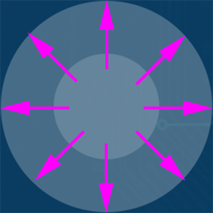
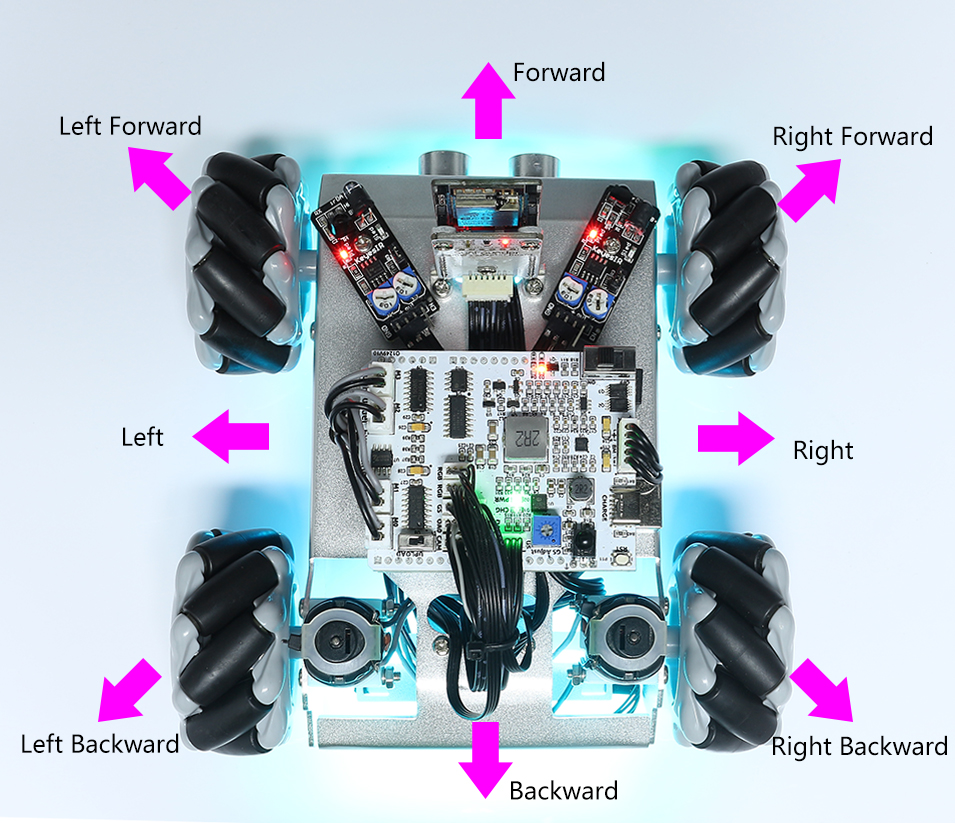
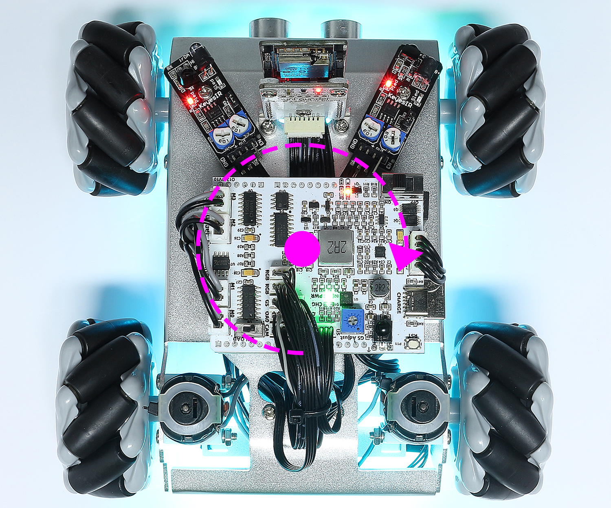

.. note:: 

    ¡Hola y bienvenido a la comunidad de entusiastas de SunFounder Raspberry Pi & Arduino & ESP32 en Facebook! Únete a otros apasionados para profundizar en Raspberry Pi, Arduino y ESP32.

    **¿Por qué unirse?**

    - **Soporte experto**: Resuelve problemas postventa y desafíos técnicos con la ayuda de nuestra comunidad y equipo.
    - **Aprende y comparte**: Intercambia consejos y tutoriales para mejorar tus habilidades.
    - **Vistas previas exclusivas**: Obtén acceso anticipado a nuevos productos y adelantos especiales.
    - **Descuentos especiales**: Disfruta de descuentos exclusivos en nuestros productos más recientes.
    - **Promociones y sorteos festivos**: Participa en sorteos y promociones especiales durante las festividades.

    👉 ¿Listo para explorar y crear con nosotros? Haz clic en [|link_sf_facebook|] y únete hoy mismo.

.. _play_app_control:

Control mediante la APP
===========================

Para controlar el Zeus Car desde tu dispositivo móvil, primero debes descargar la aplicación SunFounder Controller, conectarte a la red LAN del Zeus Car y luego crear tu propio controlador dentro de la APP.

.. raw:: html

    

        <video center loop autoplay muted style = "max-width:70%">
            <source src="../_static/video/app_control.mp4"  type="video/mp4">
            Your browser does not support the video tag.
        </video>
    

.. raw:: html
    
       

Guía rápida
---------------------

Este es un video tutorial breve. Te recomendamos verlo primero y luego seguir las instrucciones que se proporcionan a continuación.

.. raw:: html

    

        <video loop controls style = "max-width:90%">
            <source src="../_static/video/app_control_quick_guide.mp4"  type="video/mp4">
            Your browser does not support the video tag.
        </video>
    

.. raw:: html
    
       

#. Encendamos el Zeus Car.
   
   * Cuando se usa por primera vez o si el cable de la batería ha sido desconectado, el Zeus Car Shield activará su circuito de protección contra sobre-descarga.
   * Para desactivar la protección, conecta un cable Type-C durante aproximadamente 5 segundos.
   
     .. raw:: html
     
         

             <video center loop autoplay muted style = "max-width:70%">
                 <source src="../_static/video/activate_battery.mp4"  type="video/mp4">
                 Your browser does not support the video tag.
             </video>
         

     
     .. raw:: html
         
          
   
   * Si el indicador de encendido se ilumina, significa que la protección ha sido desactivada. Ahora revisa los indicadores de batería: si ambos están apagados, continúa cargando la batería con el cable Type-C.
   
     .. image:: img/zeus_power.jpg
         :width: 500
         :align: center
     
     .. raw:: html
         
            
   
   * Ahora, debes mover el interruptor más pequeño hacia la derecha para establecer la comunicación entre el coche y la ESP32-CAM. Luego, presiona el botón Reset para reiniciar el código. En este punto, verás que las luces inferiores cambian de color naranja a azul claro.
   
     .. raw:: html
     
         

             <video center loop autoplay muted style = "max-width:70%">
                 <source src="../_static/video/re_run_code.mp4"  type="video/mp4">
                 Your browser does not support the video tag.
             </video>
         

     
     .. raw:: html
         
          

#. Instala `SunFounder Controller <https://docs.sunfounder.com/projects/sf-controller/en/latest/>`_ desde la **APP Store (iOS)** o **Google Play (Android)**.

#. Conéctate a la red WLAN ``Zeus_Car-XXXXXX``.

   * Busca ``Zeus_Car-XXXXXX`` en el WLAN de tu teléfono móvil (tableta), introduce la contraseña ``12345678`` y conéctate. ``XXXXXX`` son los últimos seis caracteres de la dirección MAC del ESP32 CAM, por lo que el nombre del punto de acceso es distinto en cada coche.

     .. image:: ../img/faq_connect_zeuscar.jpg
         :width: 400

   * El modo de conexión por defecto es el modo AP. Después de conectar aparecerá un aviso indicando que esta red WLAN no tiene acceso a Internet; elige continuar con la conexión.

     .. image:: img/app_no_internet.png

#. Crear un controlador.

   * Para agregar un controlador en SunFounder Controller, toca el ícono **+**.

     .. image:: img/app1.png
         :width: 500
         :align: center
     
     .. raw:: html
         
            

   * Hay controladores predefinidos para algunos productos. En este caso, selecciona **Zeus Car**, asígnale un nombre o simplemente presiona **Confirm**.

     .. image:: img/app_preset.jpg
         :width: 500
         :align: center
     
     .. raw:: html
         
            

   * Una vez dentro, la aplicación buscará automáticamente el Zeus Car. Tras unos segundos, aparecerá el mensaje "Conectado con éxito".

     .. image:: img/app_edit.jpg
         :width: 500
         :align: center
     
     .. raw:: html
         
           

   * Ahora, toca el botón |app_run| para ver la transmisión en vivo desde la cámara y controlar el coche utilizando los widgets disponibles.

     .. image:: img/app_run123.png
         :width: 500
         :align: center
     
     .. raw:: html
         
            

#. Funciones de los widgets.

        * :ref:`app_compass_cali`: Activar la calibración de la brújula.
        * **Stop(F)**: Detiene todos los movimientos del coche.
        * **Reset Heading(G)**: Coloca el coche en la dirección deseada con la mano y presiona este widget para establecer esa dirección como la referencia de movimiento. Esto permite cambiar de dirección rápidamente sin necesidad de girar lentamente con otros controles.
        * :ref:`app_speech_control`: Cambiar al modo de control por voz.
        * :ref:`app_drift`: Activar la función de derrape.
        * :ref:`app_move`: Controlar el coche en todas las direcciones.

        * :ref:`app_line_track`: Los siguientes widgets permiten cambiar al modo de seguimiento de línea.

            * **Line no Mag(M)**: Activa el seguimiento de línea sin la influencia del campo magnético. Durante el proceso, la orientación del Zeus Car cambiará constantemente.
            * **Line(N)**: Activa el seguimiento de línea, pero con el campo magnético activo, lo que mantiene el coche orientado en una dirección específica.

        * :ref:`app_follow`: Cambia al modo de seguimiento.
        * :ref:`app_avoid`: Cambia al modo de evitación de obstáculos.
        * :ref:`app_rotate_drift`: Controla la dirección de la parte frontal del coche.

.. _app_compass_cali:

Calibración (E)
--------------------------

Activa la calibración de la brújula presionando el botón |app_cali_e|.

Coloca el Zeus Car sobre una superficie plana. Una vez que inicies la calibración, el coche comenzará a girar en sentido antihorario y se detendrá aproximadamente después de 1 minuto. Si continúa girando por más de 2 minutos, el campo magnético en ese lugar es complicado. Intenta cambiar de ubicación e inicia la calibración nuevamente.

.. _app_drift:

Habilitar Derrape (J)
-------------------------

Presiona el botón |app_drift_j| para activar la función de derrape.

* Al deslizar el widget |app_rotate_q| en sentido antihorario, verás que el Zeus Car derrapa hacia la derecha. Cuando sueltes el control, el coche se detendrá en su posición actual.

.. image:: img/zeus_drift_left.jpg
    :width: 500
    :align: center

.. raw:: html
    
       
 
* Del mismo modo, si deslizas el widget |app_rotate_q| en sentido horario, el Zeus Car derrapará hacia la izquierda y se detendrá en su posición actual.

.. image:: img/zeus_drift_right.jpg
    :width: 500
    :align: center

.. raw:: html
    
       

.. _app_move:

Movimiento en Todas las Direcciones (K)
------------------------------------------

.. raw:: html

   <video loop autoplay muted style = "max-width:80%">
      <source src="../_static/video/basic_movement.mp4"  type="video/mp4">
      Your browser does not support the video tag.
   </video>

.. raw:: html
    
         

El Zeus Car se moverá en la dirección correspondiente cuando deslices el widget |app_move_k|.

.. raw:: html
    
       

El coche se moverá cada vez que deslices el control. Si mantienes presionado el widget sin soltarlo, el coche continuará en movimiento.

.. raw:: html
    
       

.. _app_speech_control:

Control por Voz (I)
---------------------

Presionando el widget |app_speech_m|, puedes activar la función STT (Speech to Text).

La aplicación SunFounder Controller se integra con el motor de reconocimiento de voz de tu dispositivo móvil. Cuando presiones y mantengas el widget **Speech (I)** en la aplicación y hables al micrófono de tu móvil, el dispositivo convertirá tu voz en texto y lo enviará al Zeus Car.

Si el texto coincide con los comandos predefinidos en el código, el coche ejecutará la acción correspondiente.

Los siguientes comandos están predefinidos en el código. Di cualquiera de ellos y observa cómo responde el Zeus Car:

* ``stop``: Detiene todos los movimientos del coche.
* ``pause``: Funciona de manera similar a *Stop*, pero si la orientación del coche no coincide con la dirección original, girará lentamente hasta alinearse.
* ``forward``: Avanza hacia adelante.
* ``backward``: Retrocede.
* ``left forward``: Avanza hacia la izquierda.
* ``left backward``: Retrocede hacia la izquierda.
* ``right forward``: Avanza hacia la derecha.
* ``right backward``: Retrocede hacia la derecha.
* ``move left``: Se desplaza hacia la izquierda.
* ``move right``: Se desplaza hacia la derecha.

.. note::

    La función STT (Speech to Text) requiere conexión a Internet y servicios de Google en dispositivos Android. Sin embargo, esto no funciona con el modo predefinido AP (Access Point) en el Zeus Car.

    En el modo AP, el Zeus Car crea una red Wi-Fi local a la que se puede conectar tu dispositivo móvil, pero sin acceso a Internet.

    Para usar la función STT en Android, cambia el código del coche de modo AP a modo STA, como se explica en :ref:`stt_android`.

.. note::

    Los dispositivos iOS, al utilizar un motor de reconocimiento de voz sin conexión, funcionan correctamente tanto en modo AP como en modo STA.

Una vez que el coche recibe cualquiera de los 8 comandos anteriores, continuará moviéndose en la dirección indicada hasta que reciba el comando ``stop`` o ``pause``.

* ``turn left``: Este comando hará que el coche gire 45° a la izquierda con el cuerpo como punto de giro. Luego, continuará avanzando o se detendrá según su estado anterior.  
  * Si estaba detenido, se detendrá después de girar 45°.  
  * Si estaba avanzando, continuará moviéndose tras completar el giro.

.. image:: img/zeus_turn_left.jpg
    :width: 500
    :align: center

.. raw:: html
    
       
    
* ``turn right``: Este comando hará que el coche gire 45° a la derecha con el cuerpo como punto de giro. Luego, continuará avanzando o se detendrá según su estado anterior.

.. raw:: html
    
       
 
.. _app_line_track:

Seguimiento de Línea
-----------------------

.. raw:: html

   <video loop autoplay muted style = "max-width:80%">
      <source src="../_static/video/drift_based_line_following.mp4"  type="video/mp4">
      Your browser does not support the video tag.
   </video>

.. raw:: html
    
         

Haz clic en el widget |app_line_n| para cambiar al modo de seguimiento de línea.

Dos modos de seguimiento de línea están disponibles en el Zeus Car, uno con su cabeza siempre orientada en la dirección del movimiento y otro con su cabeza fija en una dirección determinada. Aquí, se selecciona el segundo modo.

#. Pega una línea de 3 cm de ancho

    Hay ocho sensores en el módulo Omni Grayscale, y la distancia entre cada sensor está entre 2 y 3 cm. Debe haber dos sensores detectando la línea negra simultáneamente. Por lo tanto, la línea que pegues debe tener al menos 3 cm de ancho y el ángulo de curva no debe ser menor a 90°.

    .. image:: img/map.png
        :width: 500
        :align: center

    .. raw:: html
        
           
    
#. Calibra el módulo Omni Grayscale

    Dado que cada superficie tiene valores de escala de grises distintos, el umbral de fábrica puede no ser adecuado para el entorno actual.  
    Se recomienda calibrar el módulo antes de su uso y siempre que el color del suelo cambie significativamente.

    * Coloca el Zeus Car sobre una superficie blanca y ajusta el potenciómetro hasta que el LED del sensor de escala de grises se ilumine.

    .. image:: img/zeus_line_calibration.jpg
        :width: 500
        :align: center

    .. raw:: html
        
           
    
    * Posiciona los dos sensores laterales justo entre la línea negra y la superficie blanca, y gira lentamente el potenciómetro hasta que el indicador de señal se apague.

    .. image:: img/zeus_line_calibration1.jpg
        :width: 500
        :align: center

    .. raw:: html
        
           
    
   * Puedes mover repetidamente el Zeus Car sobre la línea negra y la superficie blanca para asegurarte de que las luces del sensor de escala de grises se apaguen cuando estén entre la línea negra y la superficie blanca, y se enciendan cuando estén sobre la superficie blanca, lo que indica que el módulo ha sido calibrado correctamente.

#. Coloca el Zeus Car sobre la línea que has pegado, haz clic en el widget |app_line_n| y seguirá la línea.

#. Debido a los altos requisitos ambientales del módulo Omni Grayscale, se recomienda calibrarlo varias veces si el seguimiento no es satisfactorio (desviación de la línea).

.. _app_follow:

Modo Seguimiento (O)
------------------------

.. raw:: html

   <video loop autoplay muted style = "max-width:80%">
      <source src="../_static/video/object_following.mp4"  type="video/mp4">
      Your browser does not support the video tag.
   </video>

.. raw:: html
    
         

Presiona el widget |app_follow_o| para activar el modo de seguimiento.

El sensor ultrasónico detecta obstáculos a 20 cm de distancia y los sigue. 

Además, los dos módulos de evasión de obstáculos permiten que el coche siga objetos a la izquierda o derecha, pero antes de usarlos deben ser calibrados (15 cm).

#. Calibra el módulo de evasión de obstáculos IR

    * Comienza ajustando el módulo derecho. Durante el transporte, los golpes pueden hacer que el transmisor y el receptor del módulo se desalineen.  
      Asegúrate de enderezarlos manualmente.

        .. raw:: html

            <video loop autoplay muted style = "max-width:80%">
                <source src="../_static/video/toggle_avoid.mp4"  type="video/mp4">
                Your browser does not support the video tag.
            </video>

        .. raw:: html
            
                 

    * Coloca un obstáculo a unos 15 cm del módulo de evitación de obstáculos por infrarrojos.
    * En el módulo hay dos potenciómetros, uno para ajustar la potencia de emisión y otro para ajustar la frecuencia de emisión. Ajustando estos dos potenciómetros, puedes modificar la distancia de detección.
    * Luego, ajusta un potenciómetro y, si a 15 cm la luz de señal del módulo se enciende, el ajuste ha sido exitoso; si no, ajusta el otro potenciómetro.

    .. image:: img/zeus_ir_avoid.jpg
        :width: 400
        :align: center

    .. raw:: html
        
           
      
    * Calibra el otro módulo de evitación de obstáculos de la misma manera.

#. Coloca el Zeus Car sobre una mesa o el suelo y deja que siga tu mano u otros obstáculos.

.. _app_avoid:

Evitación de obstáculos (P)
------------------------------

.. raw:: html

   <video loop autoplay muted style = "max-width:80%">
      <source src="../_static/video/obstacle_avoidance.mp4"  type="video/mp4">
      Your browser does not support the video tag.
   </video>

.. raw:: html
    
         

Cuando quieras activar el modo de evitación de obstáculos, haz clic en el widget |app_avoid_p|, pero primero consulta la sección :ref:`app_follow` para calibrar los dos módulos de evitación de obstáculos.

* El Zeus Car avanzará.
* Un módulo ultrasónico detecta obstáculos al frente y, si detecta uno, el coche girará a la izquierda.
* Cuando el módulo de evitación de obstáculos izquierdo detecta un obstáculo, el coche girará a la derecha, y cuando el módulo de evitación de obstáculos derecho detecta un obstáculo, el coche girará a la izquierda.

.. _app_rotate_drift:

Control de dirección (Q)
-------------------------------

* Cuando el botón |app_drift_j| está activado, el widget |app_rotate_q| permite que el Zeus Car derrape hacia la izquierda y la derecha.

* Cuando el widget |app_drift_j| está desactivado, el widget |app_rotate_q| se usa para controlar la dirección del coche.

    * Si deslizas el widget |app_rotate_q| en sentido antihorario, el coche también girará en sentido antihorario. Al soltarlo, la cabeza del coche volverá a su dirección original.

    .. image:: img/zeus_turn_left.jpg
        :width: 500
        :align: center

    .. raw:: html
        
           
    
    * De manera similar, si deslizas el widget |app_rotate_q| en sentido horario, el coche girará en sentido horario y regresará a su dirección original al soltarlo.

    .. image:: img/zeus_turn_right.jpg
        :width: 500
        :align: center

    .. raw:: html
        
           
    

