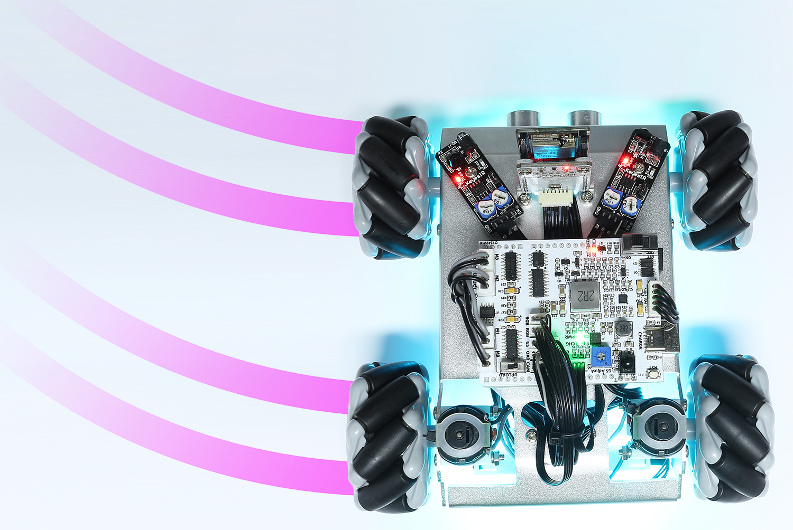
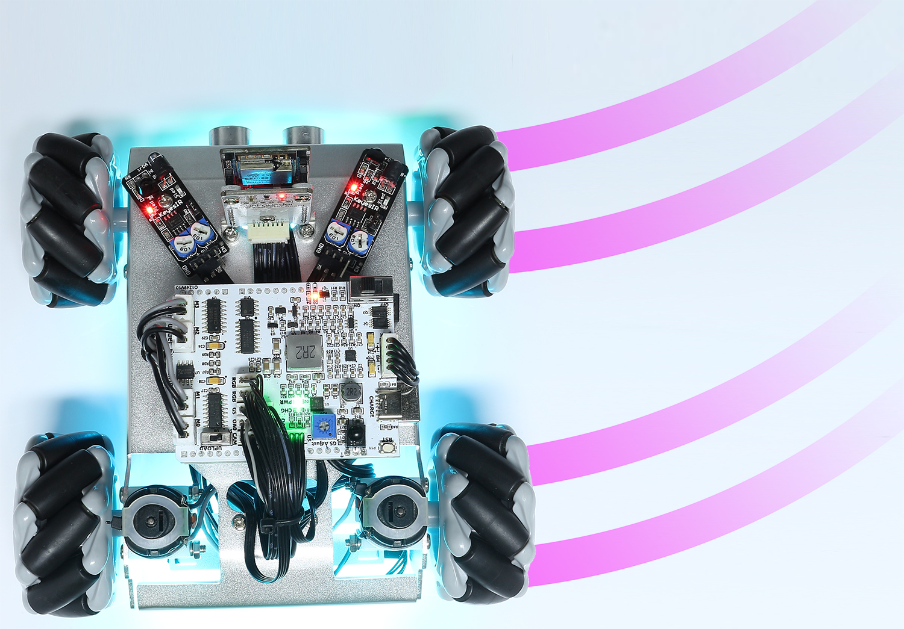
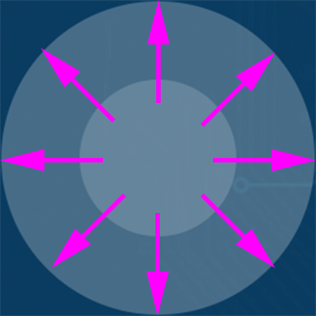
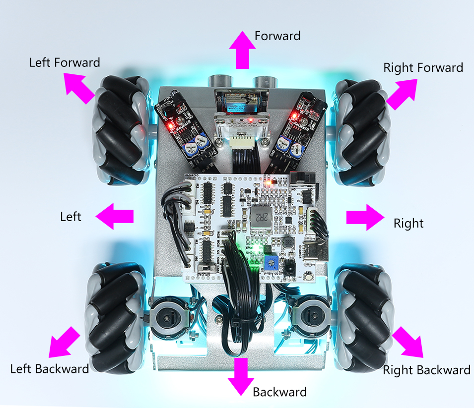
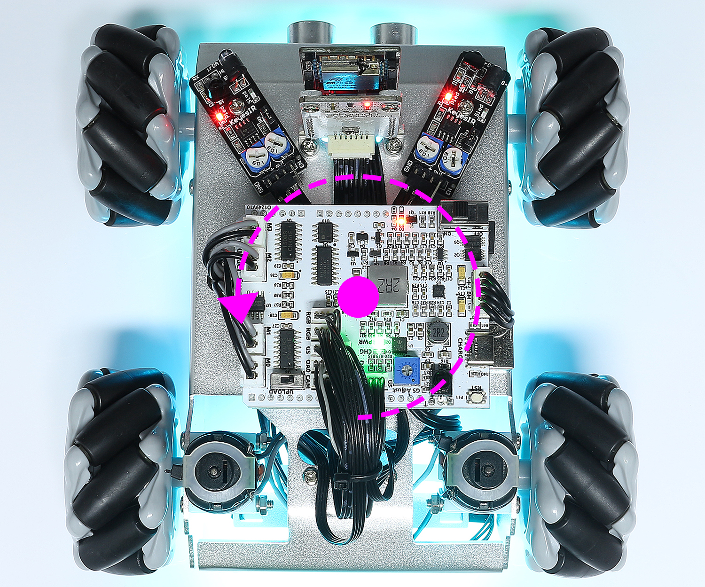
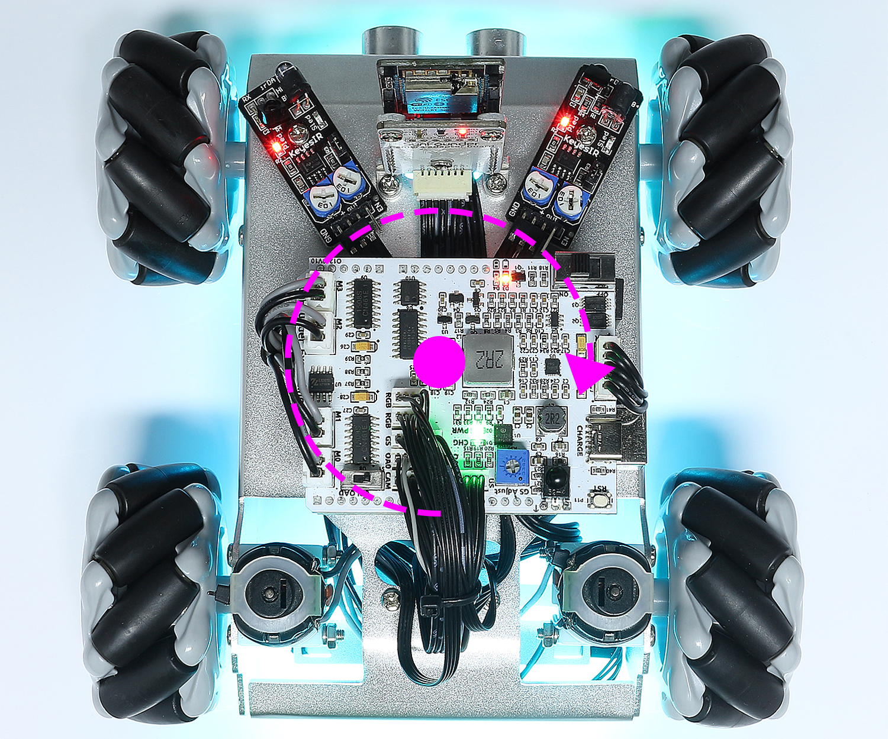

.. note:: 

    Ciao, benvenuto nella Community di appassionati di SunFounder Raspberry Pi, Arduino e ESP32 su Facebook! Approfondisci la tua conoscenza di Raspberry Pi, Arduino ed ESP32 insieme ad altri appassionati.

    **Perché unirsi?**

    - **Supporto esperto**: Risolvi problemi post-vendita e sfide tecniche con l’aiuto della nostra community e del nostro team.
    - **Impara e condividi**: Scambia consigli e tutorial per migliorare le tue competenze.
    - **Anteprime esclusive**: Ottieni accesso anticipato agli annunci sui nuovi prodotti e alle anteprime esclusive.
    - **Sconti speciali**: Approfitta di sconti esclusivi sui nostri prodotti più recenti.
    - **Promozioni festive e giveaway**: Partecipa a giveaway e promozioni per le festività.

    👉 Pronto a esplorare e creare con noi? Clicca su [|link_sf_facebook|] e unisciti oggi stesso!

.. _ar_app_control_plus:

18. APP Control Plus
=======================

Questo progetto integra le funzioni di tracciamento della linea, follow e evitamento degli ostacoli basandosi su :ref:`ar_app_control`.

.. raw:: html

   <video loop autoplay muted style = "max-width:80%">
      <source src="../_static/video/app_control.mp4"  type="video/mp4">
      Your browser does not support the video tag.
   </video>

.. raw:: html
    
       

.. note::
    Installa `SunFounder Controller <https://docs.sunfounder.com/projects/sf-controller/en/latest/>`_ dall’ **App Store (iOS)** o **Google Play (Android)**.

**Come fare?**

#. La ESP32-CAM e la scheda Arduino condividono gli stessi pin RX (ricezione) e TX (trasmissione). Quindi, quando carichi il codice, devi prima scollegare la ESP32-CAM per evitare conflitti o problemi potenziali.

    .. image:: img/unplug_cam.png
        :width: 400
        :align: center

#. Apri il file ``18_app_control_plus.ino`` nel percorso ``zeus-car-main\examples\18_app_control_plus``.

    .. raw:: html

        <iframe src=https://create.arduino.cc/editor/sunfounder01/b67e7245-369b-4218-b12c-d73f95ac3b22/preview?embed style="height:510px;width:100%;margin:10px 0" frameborder=0></iframe>

#. Dopo aver caricato con successo il codice, puoi ricollegare la ESP32-CAM e poi spostare l'interruttore di alimentazione su ON per avviare la Zeus Car.

    .. image:: img/plug_esp32_cam.jpg
        :width: 300
        :align: center
        
#. Sposta l'interruttore di upload sulla posizione Run (lato destro in questo schema) per avviare la ESP32-CAM. 

    .. image:: img/zeus_run.jpg

#. Premi il pulsante di reset per riavviare il programma sulla scheda Arduino.

    .. image:: img/zeus_reset_button.jpg

#. Connettiti alla rete WLAN ``Zeus_Car-XXXXXX``.

    * Trova ``Zeus_Car-XXXXXX`` nella lista delle reti WLAN del tuo telefono (o tablet), inserisci la password ``12345678`` e connettiti. ``XXXXXX`` sono gli ultimi sei caratteri dell'indirizzo MAC dell'ESP32 CAM, quindi il nome dell'hotspot è diverso per ogni automobile.

      .. image:: ../img/faq_connect_zeuscar.jpg
          :width: 400

    * La modalità di connessione predefinita è la modalità AP. Dopo la connessione compare un avviso che questa rete WLAN non ha accesso a Internet; scegli di continuare la connessione.

      .. image:: img/app_no_internet.png

#. Crea un controller.

    * Per aggiungere un controller in SunFounder Controller, clicca sull'icona **+**.

    .. image:: img/app1.png
        :width: 500
        :align: center

    .. raw:: html
        
           
    
    * Alcuni prodotti dispongono di controller preconfigurati. Qui selezioniamo **Zeus Car**. Assegna un nome al controller o premi semplicemente **Confirm**.

    .. image:: img/app_preset.jpg
        :width: 500
        :align: center

    .. raw:: html
        
           
    
    * Una volta dentro, l'app cercherà automaticamente la Zeus Car. Dopo alcuni istanti, vedrai un messaggio che conferma "Connessione riuscita."

    .. image:: img/app_edit.jpg
        :width: 500
        :align: center

    .. raw:: html
        
          

    * Ora, tocca il pulsante |app_run| per visualizzare il video in diretta dalla fotocamera e controllare il veicolo utilizzando i widget disponibili. 
    
    .. image:: img/app_run123.png
        :width: 500
        :align: center

    .. raw:: html
        
           

#. Ecco le funzioni dei widget disponibili.

        * :ref:`app_compass_cali`: Attiva la calibrazione della bussola.
        * **Stop(F)**: Ferma tutti i movimenti della vettura.
        * **Reset Heading(G)**: Dopo aver posizionato manualmente la vettura in una direzione, clicca su questo widget per impostare quella direzione come fronte di movimento. Questo permette di orientare rapidamente il veicolo senza doverlo girare manualmente.
        * :ref:`app_speech_control`: Passa alla modalità di controllo vocale.
        * :ref:`app_drift`: Attiva la funzione di drift.
        * :ref:`app_move`: Controlla il movimento della vettura in tutte le direzioni.
        
        * :ref:`app_line_track`: I seguenti due widget consentono di passare alla modalità di tracciamento della linea.
        
            * **Line no Mag(M)**: Attiva la modalità di tracciamento della linea senza essere influenzato dal campo magnetico. Durante il tracciamento, l'orientamento della Zeus Car cambierà continuamente.
            * **Line(N)**: Attiva la modalità di tracciamento della linea con l’influenza del campo magnetico, mantenendo l’orientamento della Zeus Car in una direzione specifica.

        * :ref:`app_follow`: Passa alla modalità di inseguimento.
        * :ref:`app_avoid`: Passa alla modalità di evitamento degli ostacoli.
        * :ref:`app_rotate_drift`: Controlla la direzione della testa del veicolo.

.. _app_compass_cali:

Calibration(E) 
--------------------------

Attiva la calibrazione della bussola cliccando sul pulsante |app_cali_e|.

Posiziona la Zeus Car a terra. Una volta avviata la calibrazione della bussola, l'auto inizierà a ruotare in senso antiorario e si fermerà dopo circa 1 minuto. Se la rotazione dura più di 2 minuti, significa che il campo magnetico in questa area è complesso. Prova a cambiare posizione e ripeti la calibrazione.

.. _app_drift:

Drift Enable(J)
---------------------

Clicca sul pulsante |app_drift_j| per attivare la funzione di drift.

* Facendo scorrere il widget |app_rotate_q| in senso antiorario, vedrai la Zeus Car derapare verso destra. Rilasciando il controllo, l'auto si fermerà nella posizione attuale.

.. raw:: html
    
       
 
* Allo stesso modo, facendo scorrere il widget |app_rotate_q| in senso orario, la Zeus Car deraperà verso sinistra e si fermerà nella posizione attuale.

.. raw:: html
    
       
 
.. _app_move:

Move in All Directions(K)
----------------------------------

.. raw:: html

   <video loop autoplay muted style = "max-width:80%">
      <source src="../_static/video/basic_movement.mp4"  type="video/mp4">
      Your browser does not support the video tag.
   </video>

.. raw:: html
    
         

La Zeus Car si muoverà nella direzione corrispondente quando scorri il widget |app_move_k|.

.. raw:: html
    
       

L'auto si muove ogni volta che trascini il widget. Se tieni il dito premuto senza rilasciare, l'auto continuerà a muoversi.

.. raw:: html
    
       
 
.. _app_speech_control:

Speech(I)
-------------------

Premendo il widget |app_speech_m|, puoi attivare la funzione STT (Speech to Text).

L'app SunFounder Controller si integra con il motore di riconoscimento vocale del tuo dispositivo mobile. Toccando e tenendo premuto il widget **Speech(I)** nell’app SunFounder Controller, puoi parlare direttamente nel microfono del dispositivo.

Il tuo dispositivo catturerà il comando vocale, lo convertirà in testo e lo invierà alla Zeus Car. Se il testo corrisponde ai comandi preimpostati nel codice, l'auto eseguirà l'azione corrispondente.

Di seguito sono elencati i comandi attualmente preimpostati nel codice. Pronuncia uno di questi comandi e osserva la reazione della Zeus Car.

* ``stop``: Arresta tutti i movimenti dell'auto.
* ``pasue``: Simile al comando Stop, ma se la testa dell'auto non è rivolta verso la direzione preimpostata, si muoverà lentamente per allinearsi.
* ``forward``: Avanza.
* ``backward``: Indietreggia.
* ``left forward``: Avanza verso sinistra.
* ``left backward``: Indietreggia verso sinistra.
* ``right forward``: Avanza verso destra.
* ``right backward``: Indietreggia verso destra.
* ``move left``: Si sposta lateralmente a sinistra.
* ``move right``: Si sposta lateralmente a destra.

.. note::

    La funzione STT (Speech to Text) richiede una connessione a Internet e i servizi Google sui dispositivi Android. Tuttavia, questa funzione non è compatibile con la modalità predefinita AP (Access Point) della Zeus Car.

    In modalità AP, la Zeus Car crea una rete Wi-Fi locale a cui il tuo dispositivo mobile può connettersi, ma senza accesso a Internet.

    Per utilizzare la funzione STT su Android, modifica il codice della Zeus Car passando dalla modalità AP alla modalità STA come indicato in :ref:`stt_android`.

.. note::

    I dispositivi iOS, grazie a un motore di riconoscimento vocale offline, funzionano correttamente sia in modalità AP che STA.

Dopo aver ricevuto uno degli otto comandi sopra elencati, l'auto continuerà a muoversi nella direzione corrispondente fino a ricevere il comando ``stop`` o ``pasue``.

* ``turn left``: Questo comando farà girare l'auto di 45° a sinistra attorno al proprio asse. Successivamente, l’auto avanzerà o si fermerà a seconda dello stato precedente. Se lo stato precedente era "stop", l'auto si fermerà dopo la rotazione; se era "forward", continuerà ad avanzare dopo aver completato la rotazione.

.. raw:: html
    
       
 
* ``turn right``: Questo comando farà girare l'auto di 45° a destra attorno al proprio asse e, come nel caso precedente, avanzerà o si fermerà in base allo stato precedente.

.. raw:: html
    
       
 
.. _app_line_track:

Line Track 
--------------

.. raw:: html

   <video loop autoplay muted style = "max-width:80%">
      <source src="../_static/video/drift_based_line_following.mp4"  type="video/mp4">
      Your browser does not support the video tag.
   </video>

.. raw:: html
    
         

Clicca sul widget |app_line_n| per attivare la modalità di tracciamento della linea.

La Zeus Car dispone di due modalità di tracciamento: una in cui la testa del veicolo è sempre rivolta nella direzione di movimento e un’altra in cui la testa rimane orientata in una direzione fissa. In questa configurazione, viene utilizzata la seconda modalità.

#. Applica una linea larga almeno 3 cm

    Il modulo Omni grayscale dispone di otto sensori, con una distanza tra loro di circa 2-3 cm. Affinché il veicolo possa rilevare correttamente la linea, almeno due sensori devono essere in grado di percepire la linea nera contemporaneamente. Per questo motivo, la larghezza minima della linea adesiva deve essere di almeno 3 cm e l’angolo delle curve non deve essere inferiore a 90°.

    .. image:: img/map.png
        :width: 500
        :align: center

    .. raw:: html
        
           
    
#. Calibrare il modulo Omni Grayscale

    Poiché il valore di grigio del pavimento può variare, la soglia di rilevamento preimpostata in fabbrica potrebbe non essere adatta al tuo ambiente. È consigliabile calibrare il modulo prima dell'uso e ripetere la calibrazione se il colore del pavimento cambia significativamente.

    * Posiziona la Zeus Car su una superficie bianca e regola il potenziometro finché il LED del sensore di grigio si illumina appena.

    .. image:: img/zeus_line_calibration.jpg
        :width: 500
        :align: center

    .. raw:: html
        
           
    
    * Ora posiziona i due sensori di grigio laterali tra la linea nera e la superficie bianca e regola lentamente il potenziometro finché l’indicatore del segnale non si spegne.

    .. image:: img/zeus_line_calibration1.jpg
        :width: 500
        :align: center

    .. raw:: html
        
           
    
    * Muovi ripetutamente il veicolo tra la linea nera e la superficie bianca per verificare che il LED del sensore si spenga quando è tra le due aree e si illumini quando è sulla superficie bianca, confermando così che la calibrazione è riuscita.

#. Posiziona la Zeus Car sulla linea adesiva, clicca sul widget |app_line_n| e il veicolo inizierà a seguire la linea.

#. A causa delle elevate esigenze ambientali del modulo Omni Grayscale, se il tracciamento non è accurato (es. deviazioni dalla linea), è consigliabile eseguire più calibrazioni.

.. _app_follow:

Follow(O)
------------

.. raw:: html

   <video loop autoplay muted style = "max-width:80%">
      <source src="../_static/video/object_following.mp4"  type="video/mp4">
      Your browser does not support the video tag.
   </video>

.. raw:: html
    
         

Clicca sul widget |app_follow_o| per attivare la modalità di inseguimento.

Il sensore a ultrasuoni rileva ostacoli entro 20 cm e segue l'oggetto davanti a sé. I due moduli di evitamento ostacoli permettono alla Zeus Car di seguire a sinistra o a destra, ma devono essere calibrati (15 cm) prima dell’uso.

#. Calibrare il modulo di evitamento ostacoli a infrarossi

    * Inizia regolando il modulo di evitamento ostacoli destro. Durante il trasporto, il trasmettitore e il ricevitore del modulo IR possono inclinarsi a causa di urti. Assicurati di raddrizzarli manualmente.

        .. raw:: html

            <video loop autoplay muted style = "max-width:80%">
                <source src="../_static/video/toggle_avoid.mp4"  type="video/mp4">
                Your browser does not support the video tag.
            </video>

        .. raw:: html
            
                 

    * Posiziona un ostacolo a circa 15 cm dal modulo IR di evitamento ostacoli.
    * Il modulo ha due potenziometri: uno per regolare la potenza di emissione e uno per la frequenza di trasmissione. Regolando questi due potenziometri, puoi modificare la distanza di rilevamento.
    * Ruota un potenziometro e verifica che, a 15 cm di distanza, l'indicatore di segnale si illumini. Se non si accende, prova a regolare l’altro potenziometro.

    .. image:: img/zeus_ir_avoid.jpg
        :width: 400
        :align: center

    .. raw:: html
        
           
    
    * Ripeti la calibrazione per il modulo di evitamento ostacoli sinistro.

#. Posiziona la Zeus Car su un tavolo o a terra e lascia che segua la tua mano o un altro oggetto.

.. _app_avoid:

Avoid(P)
------------------------

.. raw:: html

   <video loop autoplay muted style = "max-width:80%">
      <source src="../_static/video/obstacle_avoidance.mp4"  type="video/mp4">
      Your browser does not support the video tag.
   </video>

.. raw:: html
    
         

Per attivare la modalità di evitamento ostacoli, clicca sul widget |app_avoid_p|, ma prima consulta la sezione :ref:`app_follow` per calibrare i moduli di evitamento ostacoli.

* La Zeus Car avanzerà.
* Il modulo a ultrasuoni rileva ostacoli di fronte: se rilevati, il veicolo svolta a sinistra.
* Se il modulo di evitamento ostacoli sinistro rileva un ostacolo, l’auto svolta a destra; se lo rileva quello destro, l’auto svolta a sinistra.

.. _app_rotate_drift:

Controllo della Direzione (Q)
-------------------------------

* Quando il pulsante |app_drift_j| è attivo, il widget |app_rotate_q| permette alla Zeus Car di derapare a sinistra e a destra.

* Quando il widget |app_drift_j| è disattivato, il widget |app_rotate_q| viene utilizzato per controllare la direzione della testa del veicolo.

    * Facendo scorrere il widget |app_rotate_q| in senso antiorario, l’auto ruoterà anch’essa in senso antiorario. Rilasciando il controllo, la testa del veicolo tornerà alla direzione originale.

    .. image:: img/zeus_turn_left.jpg
        :width: 500
        :align: center

    .. raw:: html
        
           
    
    * Allo stesso modo, facendo scorrere il widget |app_rotate_q| in senso orario, l’auto ruoterà in senso orario e tornerà alla direzione originale quando il controllo viene rilasciato.

    .. image:: img/zeus_turn_right.jpg
        :width: 500
        :align: center

    .. raw:: html
        
           
